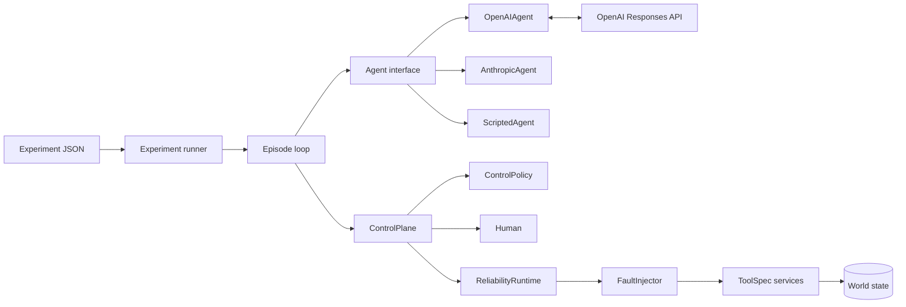
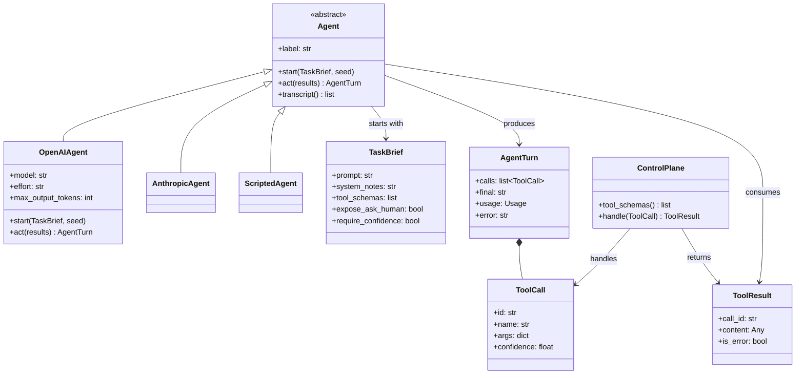
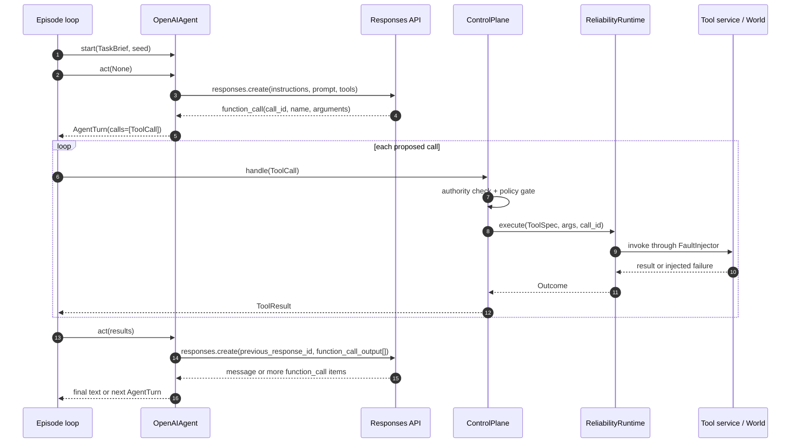
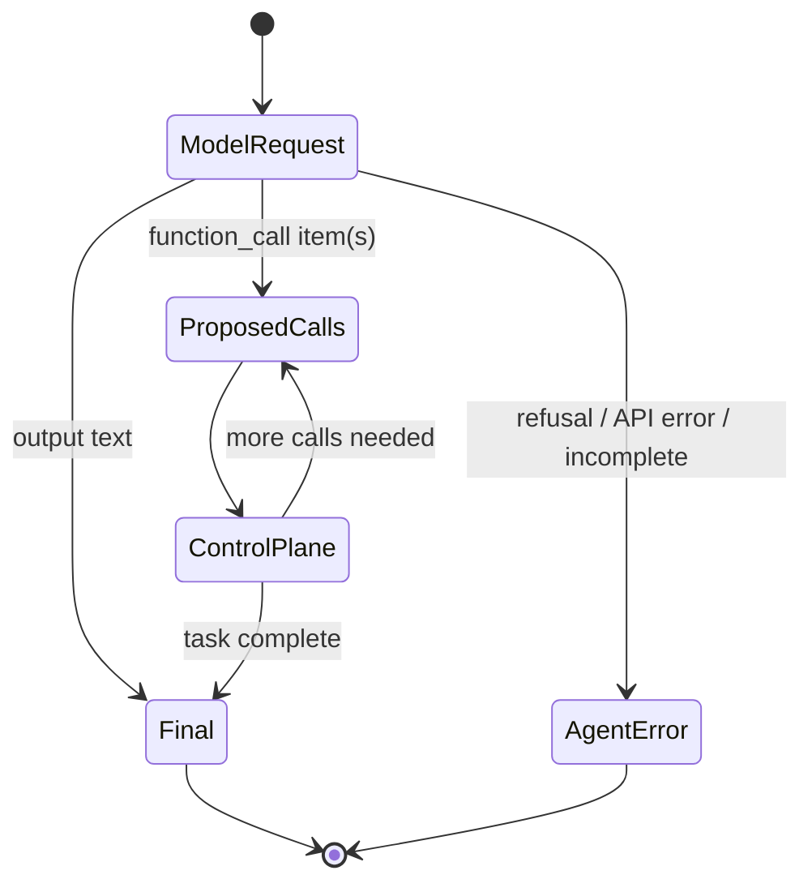

# OpenAI models in ABH

ABH integrates OpenAI API models through `OpenAIAgent`, a thin adapter around the Responses API.
The product called ChatGPT is not embedded in the harness: experiments call an OpenAI API model
by model ID. The adapter deliberately does not use a hosted agent runner because ABH must observe
and mediate every proposed tool call.

## Where the adapter fits



The provider adapter translates two things only:

1. ABH tool schemas into provider function definitions.
2. Provider response items into `AgentTurn`, `ToolCall`, and `Usage` values.

Policy, fault injection, execution recovery, human escalation, and evaluation stay provider-neutral.

## Class diagram



## Tool-call sequence



Parallel function calls in one model response become multiple `ToolCall` values. ABH currently
handles them in stable list order, preserving its deterministic world-state semantics.

## Response and execution states



The OpenAI response status is separate from ABH's tool `ExecutionState`. An API response can be
successful while a proposed real-world action is `EXECUTION_UNKNOWN`; the latter is determined by
the reliability runtime and control plane.

## Runtime deployment

```mermaid
flowchart TB
    subgraph Host[Experiment host]
      Runner[abh runner]
      Adapter[OpenAIAgent]
      CP[Control plane]
      RT[Fault injector + runtime]
      World[(In-memory World)]
    end
    subgraph Platform[OpenAI Platform]
      Responses[Responses API]
      Model[Selected API model]
    end
    Runner --> Adapter
    Adapter --> Responses : HTTPS / OPENAI_API_KEY
    Responses --> Model
    Runner --> CP
    CP --> RT
    RT --> World
```

## Configuration

CLI shorthand:

```bash
python -m abh episode travel/base --policy P6 --agent openai:gpt-5.4:high
```

Experiment JSON gives access to all adapter settings:

```json
{
  "type": "openai",
  "model": "gpt-5.4",
  "effort": "high",
  "max_output_tokens": 16000,
  "max_retries": 4,
  "timeout_s": 600,
  "input_price": 2.5,
  "output_price": 15,
  "cache_read_price": 0.25
}
```

Set `OPENAI_API_KEY` in the environment. Use a pinned model ID when the study requires a stable
treatment, and record price inputs in the experiment spec if cost is an outcome. Do not silently
fall back to another model: that would change the experimental treatment mid-episode.

## Adding another OpenAI model

No code change is normally needed. Put the API model ID in `agents[].model`, choose a supported
reasoning effort (or `null`), dry-run the experiment expansion, then run a small no-fault episode
before the factorial study. A code change is needed only when a model has a different API surface
or modality that cannot produce Responses function calls.

## Design decisions and limits

- `previous_response_id` preserves server-side response context, including reasoning items that
  should not be reconstructed by the harness. `instructions` and tool definitions are sent on
  every turn.
- `store: true` is required by this continuation strategy. Studies with a no-storage requirement
  should add an explicit stateless-history mode and verify reasoning-item handling before use.
- Provider retries cover API transport failures only. Tool/service retries remain exclusively in
  `ReliabilityRuntime`, preventing SDK behavior from bypassing the experimental treatment.
- Function definitions retain ABH's JSON Schema, including `additionalProperties: false`. Strict
  mode is not forced because ABH schemas contain genuinely optional fields; the adapter still
  parses provider arguments at its boundary, while unknown tools are rejected by the control plane.
- Known model IDs have dated pricing defaults in the adapter. Explicit prices in the experiment
  override them, so historical runs can retain their exact billing assumptions.

## Primary implementation files

| Concern | File |
|---|---|
| Provider adapter | `abh/agents/openai_agent.py` |
| Provider factory | `abh/agents/base.py` |
| CLI shorthand | `abh/cli.py` |
| Provider-neutral loop | `abh/episode.py` |
| Tool mediation | `abh/controlplane.py` |
| Example experiment | `experiments/pilot_openai.json` |
