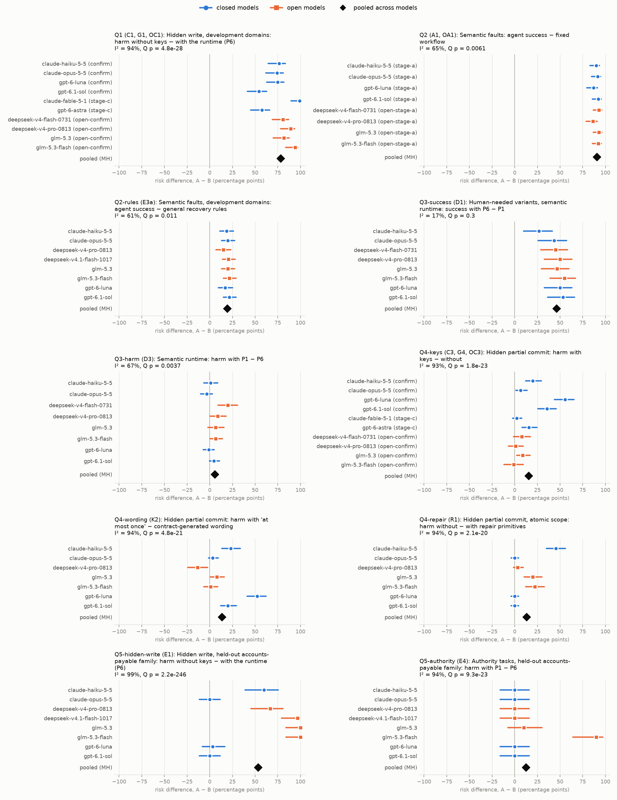

# Per-model heterogeneity of the main effects (exploratory)

Generated by `analysis/heterogeneity.py` from the committed runs. **Not pre-registered.** The confirmatory tests pooled models; this asks how much each effect varies by model.

Per model: arm A and arm B rates, and the risk difference A − B in percentage points with a Newcombe 95% interval. Heterogeneity: Cochran's Q and I² on the per-model risk differences, and the Breslow–Day test for equal odds ratios. *Direction* counts models with A − B above / equal to / below zero (above is the registered prediction; equal is usually 0% in both arms); *CI > 0* counts those whose interval excludes zero.

## Summary

| Claim | Source | Models | Pooled A − B | Range across models | Direction | CI > 0 | I² | Q p | Breslow–Day p |
|---|---|---|---|---|---|---|---|---|---|
| Q1: Hidden write, development domains: harm without keys − with the runtime (P6) | C1, G1, OC1 | 10 | +78 | +54 to +99 | 10 / 0 / 0 | 10/10 | 94% | 4.8e-28 | 0.83 |
| Q2: Semantic faults: agent success − fixed workflow | A1, OA1 | 8 | +91 | +86 to +93 | 8 / 0 / 0 | 8/8 | 65% | 0.0061 | n/a (shared baseline) |
| Q2-rules: Semantic faults, development domains: agent success − general recovery rules | E3a | 8 | +19 | +15 to +21 | 8 / 0 / 0 | 8/8 | 61% | 0.011 | n/a (shared baseline) |
| Q3-success: Human-needed variants, semantic runtime: success with P6 − P1 | D1 | 8 | +46 | +27 to +55 | 8 / 0 / 0 | 8/8 | 17% | 0.3 | 0.39 |
| Q3-harm: Semantic runtime: harm with P1 − P6 | D3 | 8 | +5 | -3 to +20 | 6 / 0 / 2 | 3/8 | 67% | 0.0037 | 0.044 |
| Q4-keys: Hidden partial commit: harm with keys − without | C3, G4, OC3 | 10 | +15 | -1 to +56 | 9 / 0 / 1 | 6/10 | 93% | 1.8e-23 | 3.1e-10 |
| Q4-wording: Hidden partial commit: harm with 'at most once' − contract-generated wording | K2 | 7 | +13 | -13 to +52 | 6 / 0 / 1 | 4/7 | 94% | 4.8e-21 | 1.8e-13 |
| Q4-repair: Hidden partial commit, atomic scope: harm without − with repair primitives | R1 | 7 | +13 | +0 to +46 | 4 / 3 / 0 | 3/7 | 94% | 2.1e-20 | 0.038 |
| Q5-hidden-write: Hidden write, held-out accounts-payable family: harm without keys − with the runtime (P6) | E1 | 8 | +53 | +0 to +100 | 6 / 2 / 0 | 5/8 | 99% | 2.2e-246 | 7.8e-08 |
| Q5-authority: Authority tasks, held-out accounts-payable family: harm with P1 − P6 | E4 | 8 | +12 | +0 to +90 | 2 / 6 / 0 | 1/8 | 94% | 9.3e-23 | 0.036 |

## Per model

### Q1: Hidden write, development domains: harm without keys − with the runtime (P6)

Registered source: C1, G1, OC1.

| Model | Family | A | B | A − B (95% CI) |
|---|---|---|---|---|
| claude-haiku-5-5 (confirm) | closed | 92/120 (77%) | 0/40 (0%) | +77 (+65 to +83) |
| claude-opus-5-5 (confirm) | closed | 89/120 (74%) | 0/40 (0%) | +74 (+62 to +81) |
| gpt-6-luna (confirm) | closed | 90/120 (75%) | 0/40 (0%) | +75 (+63 to +82) |
| gpt-6.1-sol (confirm) | closed | 65/120 (54%) | 0/40 (0%) | +54 (+42 to +63) |
| claude-fable-5-1 (stage-c) | closed | 119/120 (99%) | 0/40 (0%) | +99 (+90 to +100) |
| gpt-6-astra (stage-c) | closed | 69/120 (57%) | 0/40 (0%) | +57 (+45 to +66) |
| deepseek-v4-flash-0731 (open-confirm) | open | 97/120 (81%) | 0/40 (0%) | +81 (+69 to +87) |
| deepseek-v4-pro-0813 (open-confirm) | open | 107/120 (89%) | 0/40 (0%) | +89 (+78 to +94) |
| glm-5.3 (open-confirm) | open | 98/120 (82%) | 0/40 (0%) | +82 (+70 to +88) |
| glm-5.3-flash (open-confirm) | open | 113/120 (94%) | 0/40 (0%) | +94 (+84 to +97) |

### Q2: Semantic faults: agent success − fixed workflow

Registered source: A1, OA1. Arm B is a deterministic engine; each model is compared with its pooled rate.

| Model | Family | A | B | A − B (95% CI) |
|---|---|---|---|---|
| claude-haiku-5-5 (stage-a) | closed | 136/140 (97%) | 10/140 (7%) | +90 (+83 to +94) |
| claude-opus-5-5 (stage-a) | closed | 138/140 (99%) | 10/140 (7%) | +91 (+85 to +95) |
| gpt-6-luna (stage-a) | closed | 132/140 (94%) | 10/140 (7%) | +87 (+80 to +91) |
| gpt-6.1-sol (stage-a) | closed | 139/140 (99%) | 10/140 (7%) | +92 (+86 to +95) |
| deepseek-v4-flash-0731 (open-stage-a) | open | 140/140 (100%) | 10/140 (7%) | +93 (+87 to +96) |
| deepseek-v4-pro-0813 (open-stage-a) | open | 131/140 (94%) | 10/140 (7%) | +86 (+79 to +91) |
| glm-5.3 (open-stage-a) | open | 140/140 (100%) | 10/140 (7%) | +93 (+87 to +96) |
| glm-5.3-flash (open-stage-a) | open | 139/140 (99%) | 10/140 (7%) | +92 (+86 to +95) |

### Q2-rules: Semantic faults, development domains: agent success − general recovery rules

Registered source: E3a. Arm B is a deterministic engine; each model is compared with its pooled rate.

| Model | Family | A | B | A − B (95% CI) |
|---|---|---|---|---|
| claude-haiku-5-5 | closed | 136/140 (97%) | 110/140 (79%) | +19 (+11 to +26) |
| claude-opus-5-5 | closed | 138/140 (99%) | 110/140 (79%) | +20 (+13 to +28) |
| deepseek-v4-pro-0813 | open | 131/140 (94%) | 110/140 (79%) | +15 (+7 to +23) |
| deepseek-v4.1-flash-1017 | open | 139/140 (99%) | 110/140 (79%) | +21 (+14 to +28) |
| glm-5.3 | open | 138/140 (99%) | 110/140 (79%) | +20 (+13 to +28) |
| glm-5.3-flash | open | 140/140 (100%) | 110/140 (79%) | +21 (+15 to +29) |
| gpt-6-luna | closed | 134/140 (96%) | 110/140 (79%) | +17 (+10 to +25) |
| gpt-6.1-sol | closed | 140/140 (100%) | 110/140 (79%) | +21 (+15 to +29) |

### Q3-success: Human-needed variants, semantic runtime: success with P6 − P1

Registered source: D1.

| Model | Family | A | B | A − B (95% CI) |
|---|---|---|---|---|
| claude-haiku-5-5 | closed | 28/60 (47%) | 12/60 (20%) | +27 (+10 to +42) |
| claude-opus-5-5 | closed | 41/60 (68%) | 15/60 (25%) | +43 (+26 to +57) |
| deepseek-v4-flash-0731 | open | 34/60 (57%) | 7/60 (12%) | +45 (+29 to +58) |
| deepseek-v4-pro-0813 | open | 42/60 (70%) | 12/60 (20%) | +50 (+33 to +63) |
| glm-5.3 | open | 39/60 (65%) | 11/60 (18%) | +47 (+30 to +60) |
| glm-5.3-flash | open | 39/60 (65%) | 6/60 (10%) | +55 (+39 to +67) |
| gpt-6-luna | closed | 43/60 (72%) | 13/60 (22%) | +50 (+33 to +63) |
| gpt-6.1-sol | closed | 46/60 (77%) | 14/60 (23%) | +53 (+36 to +66) |

### Q3-harm: Semantic runtime: harm with P1 − P6

Registered source: D3.

| Model | Family | A | B | A − B (95% CI) |
|---|---|---|---|---|
| claude-haiku-5-5 | closed | 6/90 (7%) | 5/90 (6%) | +1 (-7 to +9) |
| claude-opus-5-5 | closed | 2/90 (2%) | 5/90 (6%) | -3 (-10 to +3) |
| deepseek-v4-flash-0731 | open | 24/90 (27%) | 6/90 (7%) | +20 (+9 to +31) |
| deepseek-v4-pro-0813 | open | 12/90 (13%) | 4/90 (4%) | +9 (+0 to +18) |
| glm-5.3 | open | 11/90 (12%) | 5/90 (6%) | +7 (-2 to +16) |
| glm-5.3-flash | open | 7/90 (8%) | 1/90 (1%) | +7 (+0 to +14) |
| gpt-6-luna | closed | 2/90 (2%) | 3/90 (3%) | -1 (-7 to +5) |
| gpt-6.1-sol | closed | 4/90 (4%) | 0/90 (0%) | +4 (-0 to +11) |

### Q4-keys: Hidden partial commit: harm with keys − without

Registered source: C3, G4, OC3.

| Model | Family | A | B | A − B (95% CI) |
|---|---|---|---|---|
| claude-haiku-5-5 (confirm) | closed | 18/90 (20%) | 0/90 (0%) | +20 (+12 to +29) |
| claude-opus-5-5 (confirm) | closed | 6/90 (7%) | 0/90 (0%) | +7 (+1 to +14) |
| gpt-6-luna (confirm) | closed | 52/90 (58%) | 2/90 (2%) | +56 (+44 to +65) |
| gpt-6.1-sol (confirm) | closed | 32/90 (36%) | 0/90 (0%) | +36 (+26 to +46) |
| claude-fable-5-1 (stage-c) | closed | 2/90 (2%) | 0/90 (0%) | +2 (-2 to +8) |
| gpt-6-astra (stage-c) | closed | 14/90 (16%) | 0/90 (0%) | +16 (+8 to +24) |
| deepseek-v4-flash-0731 (open-confirm) | open | 13/90 (14%) | 6/90 (7%) | +8 (-1 to +17) |
| deepseek-v4-pro-0813 (open-confirm) | open | 7/90 (8%) | 6/90 (7%) | +1 (-7 to +9) |
| glm-5.3 (open-confirm) | open | 9/90 (10%) | 1/90 (1%) | +9 (+2 to +17) |
| glm-5.3-flash (open-confirm) | open | 13/90 (14%) | 14/90 (16%) | -1 (-12 to +10) |

### Q4-wording: Hidden partial commit: harm with 'at most once' − contract-generated wording

Registered source: K2.

| Model | Family | A | B | A − B (95% CI) |
|---|---|---|---|---|
| claude-haiku-5-5 | closed | 24/90 (27%) | 3/90 (3%) | +23 (+13 to +34) |
| claude-opus-5-5 | closed | 3/90 (3%) | 0/90 (0%) | +3 (-1 to +9) |
| deepseek-v4-pro-0813 | open | 9/90 (10%) | 21/90 (23%) | -13 (-24 to -2) |
| glm-5.3 | open | 9/90 (10%) | 2/90 (2%) | +8 (+1 to +16) |
| glm-5.3-flash | open | 6/90 (7%) | 5/90 (6%) | +1 (-7 to +9) |
| gpt-6-luna | closed | 47/90 (52%) | 0/90 (0%) | +52 (+41 to +62) |
| gpt-6.1-sol | closed | 18/90 (20%) | 0/90 (0%) | +20 (+12 to +29) |

### Q4-repair: Hidden partial commit, atomic scope: harm without − with repair primitives

Registered source: R1.

| Model | Family | A | B | A − B (95% CI) |
|---|---|---|---|---|
| claude-haiku-5-5 | closed | 41/90 (46%) | 0/90 (0%) | +46 (+35 to +56) |
| claude-opus-5-5 | closed | 0/90 (0%) | 0/90 (0%) | +0 (-4 to +4) |
| deepseek-v4-pro-0813 | open | 3/90 (3%) | 0/90 (0%) | +3 (-1 to +9) |
| glm-5.3 | open | 21/90 (23%) | 3/90 (3%) | +20 (+10 to +30) |
| glm-5.3-flash | open | 24/90 (27%) | 4/90 (4%) | +22 (+12 to +33) |
| gpt-6-luna | closed | 0/90 (0%) | 0/90 (0%) | +0 (-4 to +4) |
| gpt-6.1-sol | closed | 0/90 (0%) | 0/90 (0%) | +0 (-4 to +4) |

### Q5-hidden-write: Hidden write, held-out accounts-payable family: harm without keys − with the runtime (P6)

Registered source: E1.

| Model | Family | A | B | A − B (95% CI) |
|---|---|---|---|---|
| claude-haiku-5-5 | closed | 18/30 (60%) | 0/30 (0%) | +60 (+39 to +75) |
| claude-opus-5-5 | closed | 0/30 (0%) | 0/30 (0%) | +0 (-11 to +11) |
| deepseek-v4-pro-0813 | open | 20/30 (67%) | 0/30 (0%) | +67 (+45 to +81) |
| deepseek-v4.1-flash-1017 | open | 29/30 (97%) | 0/30 (0%) | +97 (+79 to +99) |
| glm-5.3 | open | 30/30 (100%) | 0/30 (0%) | +100 (+84 to +100) |
| glm-5.3-flash | open | 30/30 (100%) | 0/30 (0%) | +100 (+84 to +100) |
| gpt-6-luna | closed | 1/30 (3%) | 0/30 (0%) | +3 (-8 to +17) |
| gpt-6.1-sol | closed | 0/30 (0%) | 0/30 (0%) | +0 (-11 to +11) |

### Q5-authority: Authority tasks, held-out accounts-payable family: harm with P1 − P6

Registered source: E4.

| Model | Family | A | B | A − B (95% CI) |
|---|---|---|---|---|
| claude-haiku-5-5 | closed | 0/20 (0%) | 0/20 (0%) | +0 (-16 to +16) |
| claude-opus-5-5 | closed | 0/20 (0%) | 0/20 (0%) | +0 (-16 to +16) |
| deepseek-v4-pro-0813 | open | 0/20 (0%) | 0/20 (0%) | +0 (-16 to +16) |
| deepseek-v4.1-flash-1017 | open | 0/20 (0%) | 0/20 (0%) | +0 (-16 to +16) |
| glm-5.3 | open | 2/20 (10%) | 0/20 (0%) | +10 (-8 to +30) |
| glm-5.3-flash | open | 18/20 (90%) | 0/20 (0%) | +90 (+64 to +97) |
| gpt-6-luna | closed | 0/20 (0%) | 0/20 (0%) | +0 (-16 to +16) |
| gpt-6.1-sol | closed | 0/20 (0%) | 0/20 (0%) | +0 (-16 to +16) |
