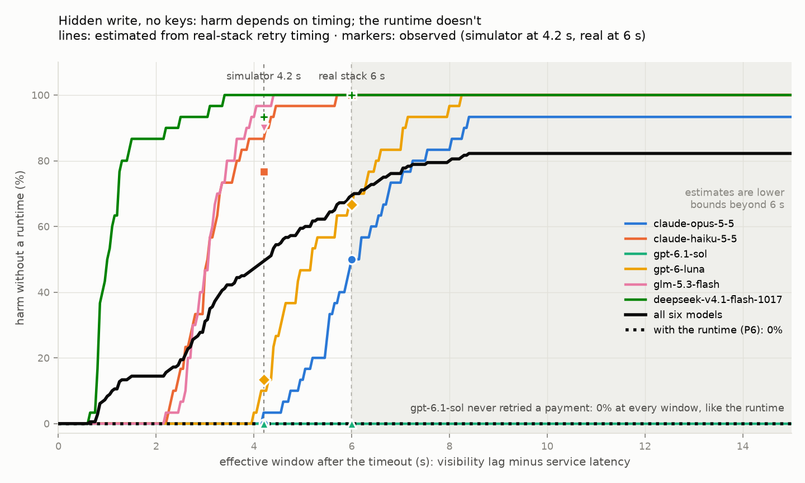

# Agent-side harm vs timing (exploratory)

Generated by `analysis/latency_sensitivity.py` from `runs/real-ledger-20261028-111807`. **Not pre-registered.**

Without a runtime, a hidden write harms an agent only if it retries the payment before the original becomes visible. The **effective window** is how long after the client's timeout a retry still reaches the service unseen: the visibility lag after the timeout minus the service latency before the check. It was 6 s on the real stack and about 4.2 s in the simulator.

Each agent's **retry gap** (timeout to next payment attempt) was measured in wall-clock time on the real stack. The rule *harm = retry gap < window* reproduces the observed outcome in 180/180 real episodes. Estimates are valid up to 6 s and lower bounds beyond (see the script's docstring). The runtime (P6) had 0/360 harm across both substrates.

## Check against the simulator

The real-stack retry gaps, evaluated at the simulator's 4.2 s window, against what the simulator observed for the same models and seeds:

| Model | Predicted at 4.2 s | Simulator observed | Real observed (6 s) |
|---|---|---|---|
| claude-opus-5-5 | 3% | 0/30 (0%) | 15/30 (50%) |
| claude-haiku-5-5 | 87% | 23/30 (77%) | 30/30 (100%) |
| gpt-6.1-sol | 0% | 0/30 (0%) | 0/30 (0%) |
| gpt-6-luna | 10% | 4/30 (13%) | 20/30 (67%) |
| glm-5.3-flash | 97% | 27/30 (90%) | 30/30 (100%) |
| deepseek-v4.1-flash-1017 | 100% | 28/30 (93%) | 30/30 (100%) |
| **all** | **49%** | **82/180 (46%)** | **125/180** |

## Harm without a runtime, by effective window

Windows beyond 6 s (in italics) are lower bounds.

| Model | 0.5 s | 1 s | 2 s | 3 s | 4 s | 4.2 s | 5 s | 6 s | *8 s* | *10 s* | *15 s* |
|---|---|---|---|---|---|---|---|---|---|---|---|
| claude-opus-5-5 | 0% | 0% | 0% | 0% | 0% | 3% | 13% | 50% | 83% | 93% | 93% |
| claude-haiku-5-5 | 0% | 0% | 0% | 47% | 87% | 87% | 97% | 100% | 100% | 100% | 100% |
| gpt-6.1-sol | 0% | 0% | 0% | 0% | 0% | 0% | 0% | 0% | 0% | 0% | 0% |
| gpt-6-luna | 0% | 0% | 0% | 0% | 3% | 10% | 47% | 67% | 97% | 100% | 100% |
| glm-5.3-flash | 0% | 0% | 0% | 47% | 93% | 97% | 100% | 100% | 100% | 100% | 100% |
| deepseek-v4.1-flash-1017 | 0% | 50% | 87% | 93% | 100% | 100% | 100% | 100% | 100% | 100% | 100% |
| all | 0% | 8% | 14% | 31% | 47% | 49% | 59% | 69% | 80% | 82% | 82% |

## What it shows

- **Agent-side harm depends on a deployment parameter.** The effective window is set by replication lag and service latency, which no agent controls and which vary across deployments and over time.
- **Models with fast retries are harmed at almost any window**; models that deliberate longer are harmed only once the window exceeds their decision time. Per-model rates measured at one window don't transfer to another.
- **The runtime is flat at 0%.** It checks before retrying. If the write stays hidden past its poll budget (about 7.5 s after the timeout), it doesn't find it and routes to a human or compensates. That costs autonomy, not safety.
