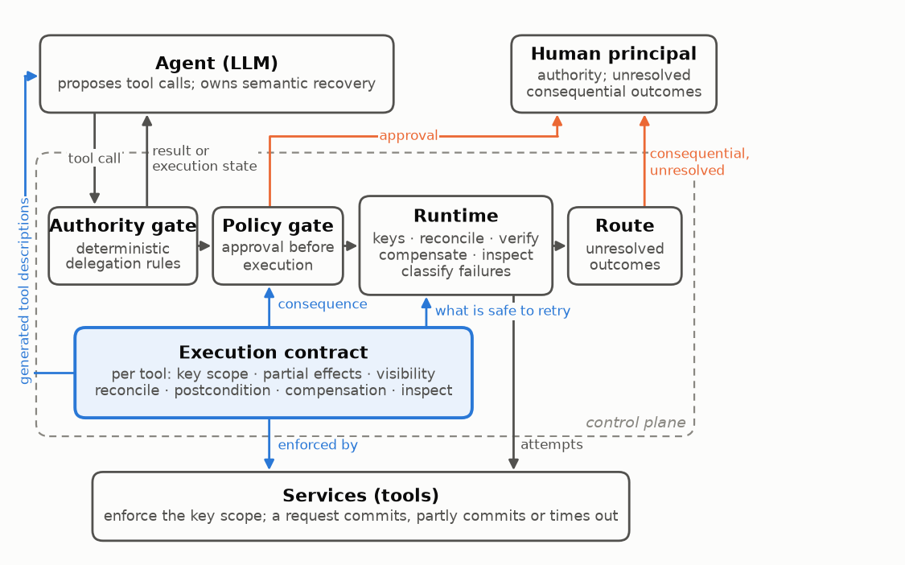
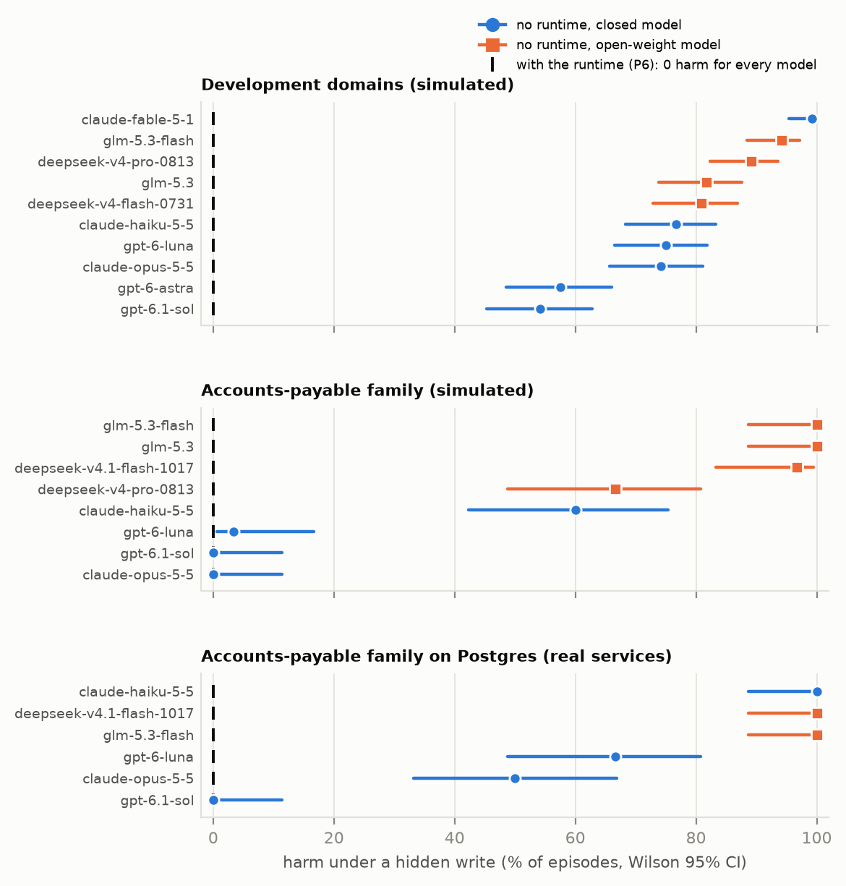
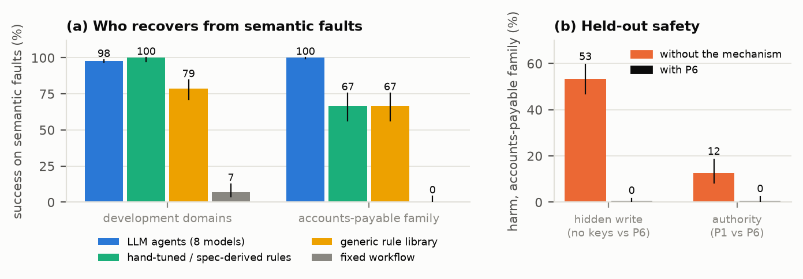
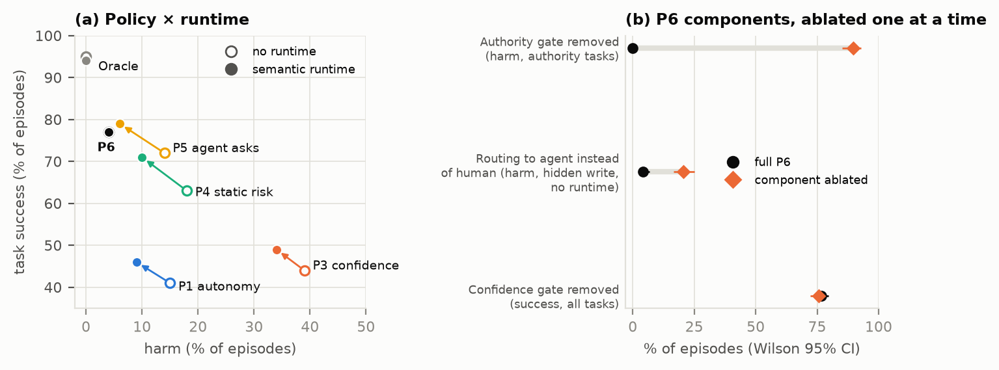
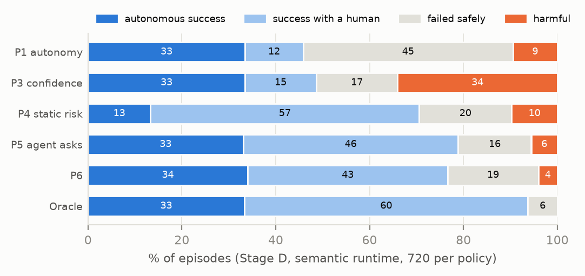
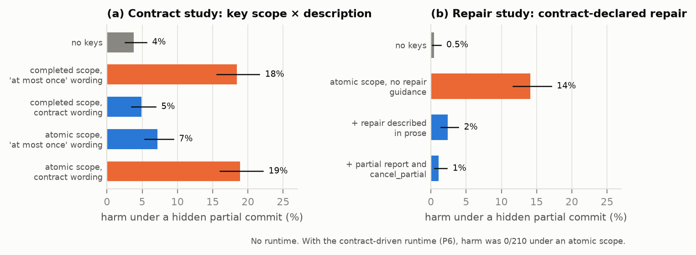
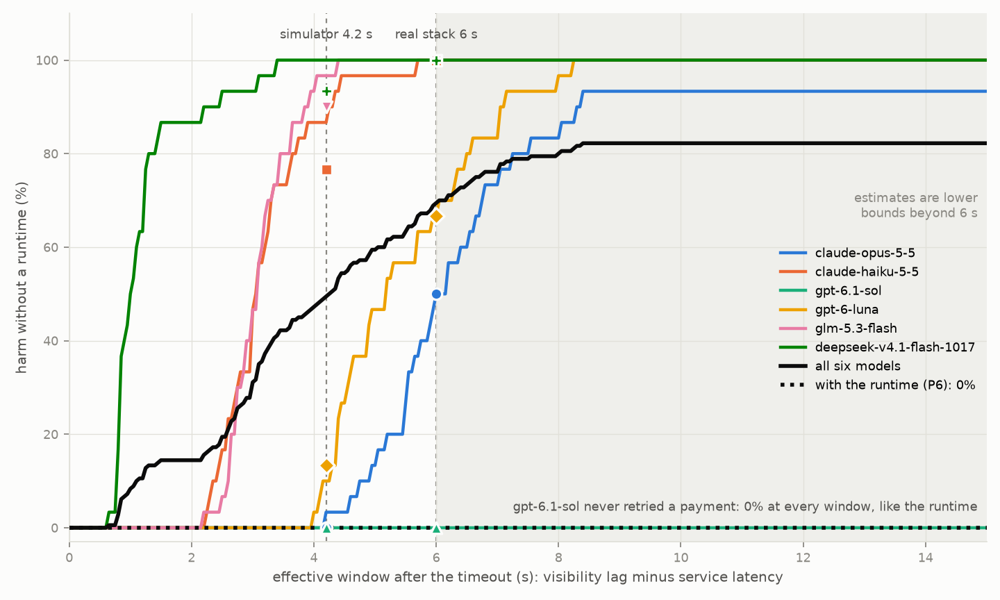

# Execution Boundaries for Agentic Systems

Author: Stacie Riddle

---

## Abstract
Tool-using LLM agents complete tasks involving stateful systems such as paying bills, booking travel arrangements, and maintaining code. Real-world anomalies in distributed systems such as network timeouts and other issues can cause ambiguity about prior writes and reads, including uncertainty about whether a write was fully successful and the inability to read newly written information. This study shows that agents perform poorly under conditions of system ambiguity and simply swapping in higher performing models such as the latest frontier models does not improve performance in these situations. 

By running simulations of common errors with 10 models from four families we show that agents without a runtime caused harm 54-99% of the time when they were exposed to a hidden, ambiguous write. The harm came in the form of duplicate payments, travel arrangements, etc. The most capable model (Fable 5.1) caused harm 99% of the time with lasting damage done in 96% of those cases. Offering idempotency key information to tool-using LLM agents increased harm 30% of the time due to exposure to a partial, ambiguous write, compared with 1%, as agents generalized the meaning of idempotency key information.

The work described in this paper demonstrates that problems such as these  can be solved at the system level. The tool-use contract is added to tool documentation that describes tool behavior more formally. It specifies the error-recovery and monitoring features offered by a tool, as well as the scope of idempotency keys and other constraints. 

The control plane in this implementation decides who resolves each kind of problem. The contract-driven runtime handles what happened to a request, the agent handles what to do next, a deterministic gate decides what the agent is permitted to do, and a human decides consequential outcomes the runtime can’t resolve. The tool-use contract gives the control plane the ability to mitigate risks by assigning different kinds of risk to different parties.

Eleven preregistered experiments with LLMs found that the tool control system prevented unseen error-related harms for all tested models after the tool control system was implemented. This result held when run on a systems using a Postgres cluster and standard HTTP servers.

The implementation of the contract further reduced the risk of improper key use from 18% to 5%, but other model-specific results suggest that risk from improper key use may increase for some key use cases until the tool use contract is updated to include methods for completing incomplete transactions, which reduced risk to 1%. The tool control system adds one additional round trip per write transaction in the absence of errors, but a fast path for completing hidden incomplete transactions using the tool use contract reduced processing time from 10s of polling to 0.2s.

---

## 1. Introduction
An agent is making a payment to a vendor on behalf of a client. A payment service tries to debit the client's account but can't finish processing the vendor invoice due to a system crash. The payment service doesn't send feedback to the client, who times out. The agent has been given an idempotency key with the property "safe to retry: it executes at most once" (a property all idempotency keys have). The agent resubmits the request using the same idempotency key. The service's database records only idempotency keys for completed requests, so the agent's resubmission causes a second debit of the client's account. A later review of the account ledger by the agent shows that the vendor invoice has been paid, and the agent reports success to the client.

Nothing in this trace is particularly unusual. Lost committed writes from timeouts and partial writes and underreplicated data with restricted keys are known challenges for distributed systems. There are known solutions to these problems, such as idempotent and saga-style transaction models and at-least-once messaging with durable messaging systems. What is novel here is the client. Developers working with today's clients see both examples of clients accessing resources beyond their granted permissions [Anthropic 2026b] and end users granting many of a client's requested permissions, making item-by-item permission review less useful [Anthropic 2026a]. Prior to agents, clients would be limited to software applications built and tested by users who have read the service's documentation and API references. Now, clients include LLMs that read a tool's documentation when prompted to use the tool. These agents are unlikely to be aware of code that restricts access to a key and are likely to interpret undocumented behavior of tools broadly and inconsistently.

Here, agent performance on this task is measured and found that agents were unsuccessful and that **increasing the amount of training data was not helpful** (Figure 2). Ten models were tested without a runtime or idempotency keys and each was found to cause harm in the event of hidden writes with timeouts and delayed visibility in at least 54% of test cases. Traces provide insight into this finding. A sample of traces (480) from six models were examined and found that the six models all rechecked state after the timeout and failed to observe a hidden write due to delayed visibility. All six models resubmitted requests as a result. The best-performing model rarely rechecked state a second time in 28% of test cases and generated final trace claiming there was only one charge. Agents are not failing to reason about the situation; they are reasoning correctly about incorrect observations.

This all brings us to the thesis that is central to this work: failures in tool use should be managed outside the model, in the agent's tool environment. Other tool environment features can assist the agent in managing failures by making information available to the agent that it otherwise would not have, so long as tool developers provide information about what their tools guarantee under failure. 

Key results of this paper include the following:

**A taxonomy of errors** agents can make during execution, including hidden implementation errors such as hidden writing and hidden partial commits, as well as observable implementation, semantic, and authority errors. Multiple parties are responsible for different implementation errors. Evidence about which errors each class concerns is reviewed (§2).

**An agent execution contract** providing additional details about restrictions on tool access and use, recovery and compensation options, and other features available to tool users. Neither JSON Schema nor MCP’s tool annotations can express key scope, partial effects, visibility lag or recovery operations, so today’s interfaces leave agents to guess them from prose. The agent execution contract assists runtimes in identifying retriable actions and is used to generate documentation on retriable and nonretriable actions and compensation strategies for nonretriable actions (§3).

**A control plane** for implementing and assigning contract responsibilities (§4): A deterministic control interface; a contract service; and a system for assigning other contract responsibilities to an individual. In the fast path, an API query to a contract service allows users to learn details about a partially ordered transaction without further queries.

The design of this system is evaluated in eleven registered studies (50,162 LLM experiments, 10 models (11 with a mid-study replacement) in four families plus a frontier tier), five development domains (travel, procurement, operations, scheduling, and SDLC), an out-of-sample accounts-payable workflow created after the project's design was finalized, and a replication study using Postgres and streaming replicas. All confirmatory hypotheses and analytic plans were preregistered. 

Important results include:

**Model capabilities don't protect against harm, and it is hard to predict which models will be harmed.** Under a hidden write, all models were harmed in at least 54% of episodes, and models in the frontier group caused more lasting damage than models in the strong group (64% and 32%, respectively). During testing, one model experienced no harm in simulation and 50% harm in a Postgres database. Service response times were unchanged between simulation and Postgres tests. Variations in service response times played a role in causing harm (§7.1, §7.7).

**A clear contract enforced outside the model can reduce risks.** Various unobservable errors injected into the services did not affect models using the contract-driven runtime in either the simulation or those using Postgres (§7.1). Benefits of the contract do not depend on which model is used or the documentation and deployment schedule provided for the tools.

**Contracts help mitigate the risks of key sharing by reducing information asymmetries about key-sharing relationships.** Using idempotent keys for transactions raised risk of potential losses by agent actions from 1% to 30% in cases of hidden partial commitment. Adding contracts with repair guidelines  lowered this risk back to 1%. Descriptions generated from the contract helped most models but hurt some; only enforcement worked for all of them (§3.3).

**Confidence is not authority.** Without a deterministic authority gate, harm rose from 0% to 90%. Escalating all authority violations to a human (simulated) doesn't work because agents were so confident that the result would be escalation of most actions (§4.7). The authority filter and other runtime and routing modifications maintained almost the same number of autonomous task actions as fully autonomous task actions (see P6), with less than half as much harm (§7.3). This approach minimizes the human in the loop.

**Agents outperform at correcting semantic errors.** Agents correct 98-100% of semantic errors, while generic and static approaches correct 79% and 7%, respectively. Agents are comparable in performance to custom hand-coded rules without requiring them to be written first (§7.2).

**Using a runtime is cheap insurance.** The runtime incurs a low cost of one extra round-trip per write in failure-free scenarios. In other failure scenarios, the runtime lowers costs to the agent by reducing the number of recovery attempts needed. A contract can offer a shortcut that enables the agent to check partial writes more quickly, in 0.2 seconds, instead of the 10 seconds it takes to poll in this simulation (see §4.3, §7.6).

The rest of this paper is organized as follows. In §2, we classify failures and assign responsibility for resolving each one. In §3, we present the execution contract. In §4, we present the control plane designed to enforce the execution contract. In §5 and §6, we present implementation and evaluation techniques. In §7, we present an evaluation of our design. In §8, we compare our work with related work. In §9, we note design limitations. Supplement S1 provides information on all implementation and operational defects in the system.

---

## 2. Background and Motivation

### 2.1 Agents: A New Type of Client

Distributed systems provide clients with various guarantees, such as at-most-once semantics for operations with a given key and the ability to retry failed operations. Production systems implement these guarantees in a variety of ways, even if the guarantees are described formally [Kleppmann 2017].  Traditional client developers learn how these guarantees are provided when working with different distributed systems through documentation and other techniques over the course of product development and use. The result of this is bespoke integrations that have been written to encode that specific context for each use of it. 

In contrast, an LLM agent has knowledge about tool capabilities through tool metadata including descriptions provided at runtime. An LLM agent has no other knowledge about tools or previous tool use experiences, including those with the tool currently in use. Tool choices are based on recent observations rather than built-in information. Different actions are not only possible for each model, but also can differ among deployments of the same model (§7.1). To offer conventional client experiences, an LLM agent system must offer consistent behavior on each use. It is difficult to offer consistent experiences to clients using only tool descriptions with an LLM agent.  

### 2.2 Agent Limitations

A response to or lack of response to requests cannot be considered a reliable source of information about events at the service. [Lamport 1978] Two specific pieces of unreliable information are:
- Timeout. The client is unaware of the problem that caused the failure to receive a server response in a timely manner. The client's request may or may not have been processed partly or fully. It may have been processed but with a delay.
- Empty read. Inserted values may not be found in lookup queries because of replication lag. The absence of a queried value does not indicate that the value is not present.

This article discusses two kinds of composite faults that include timeouts.

| Fault | Specifics | Agent Observation | Response | Actual Result |
|---|---|---|---|---|
| **Hidden write** (timeout + visibility lag) | the write committed | a timeout, then a lookup that finds nothing | conclude it didn't run; retry | a duplicate effect, e.g. a second payment |
| **Hidden partial commit** (partial failure + timeout) | the first step committed, the second didn't | a timeout | retry, with the same idempotency key if offered | the committed step repeats, because the service records keys only for completed requests |

In both cases, the agent responds correctly to the information it receives, but some of the information it received is incomplete. Efforts to improve model performance alone will not solve these vulnerabilities (§7.1).

### 2.3 Failures and Responsibilities

Classes of agent failures are defined by the information that agents have and by the availability of potential fixes. Controllers are assigned to fix the various classes of agent failures.

| Class | Example | Observable to the agent? | Owner | Evidence |
|---|---|---|---|---|
| Unobservable execution result | hidden write; hidden partial commit | no | runtime | §7.1 |
| Observable run-time failure | 5xx, 429, malformed response, visible partial failure | yes | runtime (helpful; capable models also recover) | §7.1 |
| Semantic fault | altered preconditions, unavailable tool, invalid result for given task parameters | yes, by reading carefully | agent | §7.2 |
| Authority | decisions made without proper delegation | not a matter of observation | encoded decision process with human review | §4.7, §7.3 |
| Unresolved consequential outcome | the runtime can't tell whether an irreversible write ran | no | human | §7.3 |

Reasoning for the above assignments:
- Not knowing whether a task is complete is a runtime issue. Knowing whether a task is complete does not involve value judgments. Other tasks and services provided by a service, including key search and task-completion and partial or deferred undo services, can be provided to multiple agents and clients through a runtime system. Other models with capabilities can address state-based issues for which the issue and solution are known. Runtime systems can provide capabilities to already capable models.
- Semantic errors should be fixed by agents. Some semantic errors include changes to a tool's input and output requirements and output that is not helpful to a user in completing their task. Other examples of semantic errors include all situations in which the correct action depends on the user's task. Deterministic recovery methods can only correct predictable errors, the unpredictable nature of semantic errors are where models perform well (§7.2).
- Authority over a decision belongs to a single gatekeeper. Control over access decisions has nothing to do with an agent's knowledge or cognitive abilities. An agent can have knowledge about an action it is forbidden to perform. Inferences about control cannot be made based on an agent's beliefs about a decision (§4.7).
- Other problems are addressed by humans. If the runtime cannot determine the outcome of an irreversible action, someone with more information about the overall service state is required to help address the problem. Approaches involving having the agent try the same action again to resolve the agent's problem, as discussed in §2.2, are not good approaches.

### 2.4 Limits of Idempotency Keys

Idempotency keys are one method of handling retries [Lee et al. 2015; Jena and Dalal 2025]. There are problems with idempotency key information. Different service implementations may provide different idempotency keys in different situations, such as whether the initial request succeeded, leading to problems with partial success of retried client requests. Agents we tested that received idempotency keys labeled "at most once" in the trace description had 1%-30% more hidden partial successes (C3). Labeling the idempotency key in our experiments reduced hidden agent failures to 3% (C5). Our agents were not faulty; they behaved correctly according to the information in the description, which was insufficient to support safe agent behavior.

The execution contract serves as a functional interface between program specification and implementation (§3). The contract described and documented here offers a precise definition of an idempotency-related program property that can be enforced by the service and tied to a program's specifications.

## 3. The execution contract

A tool interface includes a JSON schema for the tool input and a natural-language description of tool behavior. Both parts of a tool interface lack details about tool errors and retries. For non-agentic tool users, such details are unnecessary because they are unlikely to change and can be validated during tool development. LLM agents interact with the tool description during runtime use, and the results below suggest that LLM agents may have overly optimistic beliefs about tool capabilities (§3.3).

The execution contract specifies the tool's error-handling behavior and other service guarantees made by the tool's service provider. The three stakeholders who use the execution contract are the tool service provider, which must fulfill its contractual obligations; the runtime system, which relies on the execution contract to ensure safe runtime behavior; and tool agents, which use function descriptions extracted from the execution contract for planning.

### 3.1 Fields

| Field | Values | Description | Use by Runtime |
|---|---|---|---|
| `key_scope` | `none`, `completed`, `atomic` | scope of a client-supplied idempotency key | attach keys and replay safely; know when a keyed replay can still duplicate |
| `partial_effects` | `impossible`, `persist` | whether a request can commit part of its work, and whether that work persists | know that a timeout may hide a partial commit |
| `visibility_lag_ms` | bounded or not guaranteed | maximum delay before a read sees a write | wait for visibility instead of treating "not found" as "not executed" |
| `reconcile` | whether offered or not | key-based lookup: was this request processed? | handle timeouts based on state, not guesses |
| `postcondition` | whether offered or not | requirement on the effect that must hold if operation succeeds | check whether the operation succeeded before signaling success |
| `compensation` | whether offered or not | an undo of an *incomplete* attempt, by key | remove a hidden partial commit before replaying |
| `inspect` | whether offered or not | a consistent lookup of how far a keyed attempt got: `complete`, `partial` or `absent`, answered once any in-progress attempt with that key has finished | resolve a timeout at once, without polling (§4.3) |
| `partial_report` | yes / no | whether a partial failure reports, machine-readably, what committed | let the agent repair a visible partial outcome |
| `repair` | `none`, `prose`, `cancel_partial` | what the service offers to repair a partial outcome | expose a `cancel_partial(tool, key)` operation to the agent |

In addition to other components, the contract describes a tool's side effects and how to recover from them. The policy enforcer uses this contract to decide whether human approval is needed and which actor ultimately resolved the issue that the runtime couldn't (§4.5).

The key scope was the main cause of damage ("harm") in the experiments. Within the `completed` scope, the idempotency key should be implemented such that the system only stores completed requests in the service's idempotency key database. An initial success followed by a failure isn't stored, so a retry with the same idempotency key would result in a resubmission and redo of the initial operation. In the `atomic` scope, all parts of successfully committed requests are stored in the service's idempotency key database, so a retry with the same key would provide the prior, possibly partial, result without resubmission of already-completed portions of the request. Both practices are valid. The problem is that both practices use the term "idempotency key," and a statement such as "safe to retry: it executes at most once" applies to both practices.

There are two methods related to keys that the runtime uses:
- `compensate(key)` must undo a pending or partially completed request and take no action for a fully completed request. The compensate(key) operation might need to be invoked if the runtime cannot determine whether a request was already completed. The compensate(key) operation should take no action for fully completed requests that the runtime has not seen before.
- `inspect(key)` must be linearizable with respect to other calls to the same key. We used the same locking mechanism that our Postgres service uses for payment transactions (see §5) as a per-key advisory lock for inspect(key).

Experiments can override fields for all tools to alter service scope for observational purposes; this was done in the contract study.

### 3.2 Contract vs Existing Tool Interfaces

According to the latest protocol version (2026-07-28), a tool annotation (ToolAnnotations) defined in the MCP protocol has four fields documented as "behavioural hints," not guarantees (readOnlyHint, destructiveHint, idempotentHint, and openWorldHint). [MCP] The following table describes the use of MCP tool annotations in this implementation:

| Contract field | JSON Schema + description | MCP annotations |
|---|---|---|
| side effect, reversibility | prose | `readOnlyHint`, `destructiveHint` |
| idempotent (repeated calls have no effect) | prose | `idempotentHint` |
| key scope | prose; usually "at most once" whatever the scope | — |
| partial effects | prose, if at all | — |
| visibility lag | — | — |
| reconcile, postcondition, compensation, inspect | — | — |
| partial report, repair | — | — |

`mcp_annotations` in our code returns a map for all contracts that shows missing or unavailable data for a given episode run of the experiment. For all payment tool contracts in the held-out set, most of the output data is missing, except for the first two rows (because this data is not available for payment tool contracts in our experiment).

### 3.3 Generated descriptions

A policy can obtain a description of a key from the contract rather than from prose included with the description of a service. Systems with limited commitment options can give agents more control over their commitment behavior than unfettered use of prose descriptions, which can produce nondeterministic commitment behavior. According to the MCP documentation, output prose includes sample prose outputs.

According to the MCP documentation, output prose includes:

> Optional client-supplied key. The key is recorded only when a request completes. A request
> that failed partway is not recorded: part of it may have taken effect, and repeating it with
> the same key runs it again. After a failure or timeout, check current state before retrying.

For a tool scoped to the `atomic` level with `cancel_partial` repair behavior, the tool documentation explains that reissuing a partial submission will have the same result as the first submission and gives step-by-step guidance on how to fix a partial submission, including how to reissue a request: Call `cancel_partial` with the same key used in the original submission, then submit a full request using the same key. Do not submit new requests with different keys. Doing so could have unexpected results.

Evidence (Q4; Fig. 4). The contract reduced the damage from hidden partial  commits with a well-specified `completed` scope requirement from 18% to 5%. This implies that scope mismatches are a major driver of key-related damage and that contracts can mitigate scope mismatches. The evidence was based on 630 episodes on 7 models taken outside a runtime environment. We intend to reduce key-related damage further by applying runtime tools.

**Describing the failure accurately wasn't enough.** With an accurate contract-generated description and an atomic scope (so we were guaranteed the agent would not attempt retries) we actually observed an increase in the rate of harm from 7% to 19%. This was because partial failures were not being repaired and the handling of the situation was not being specified to the agents, who were left to their own reasoning as to whether or not to send a new request (note the disctinction from a retry - they almost always reasoned that a new request should be sent with a new key). This behavior was observed in 84 of the 270 open-model episodes in the experiment arm. Only 52% of the agent instances checked state prior to sending a new request compared with 88-99% of the agents in the other experiment arms.

After this behavior was observed, a second experiment was conducted with a repair mechanism for partial atomic transaction failures. Human descriptions of methods for repairing partial atomic transaction failures were given to the agents, and the observed rate of damage dropped from 14% to 2%. Additional specifications for a `cancel_partial(tool, key)` method were added to the contract based on these observations to further reduce observed damage to 1%. The cancel method is believed to have reduced the number of new keys repeatedly submitted by agents, as it was used 411 times out of 630 episodes. In the first study, there was no formal contract, and information about repair methods was collected by having agents interpret text fields, a type of prompt engineering. The formal contract used in the second study completely eliminated observed damage.

Selective use of words in prompts may decrease the risks to agents without protections. In our study, contract descriptions decreased risks for at least six of seven models by 1 point for GLM-5.3-Flash to 52 points for GPT-6-Luna. Contract descriptions increased risks from 10% to 23% (−13 points; I² = 94% across models) for DeepSeek V4-Pro. Selective use of words in prompts has different effects on different models and depends on other aspects of the prompt and environment in which the prompt is used.

Based on our experiences, we offer the following interface suggestions to developers of agents.
- A contract that tells an agent what went wrong should contain provisions for addressing errors and deficiencies.
- The contract description sections are among the most problematic parts of the contract. Writing descriptions benefits the agent. Writing descriptions does not help predict the agent's future behavior.

At this point, we note that all descriptions in our experiments were in English and we have not explored whether any of the effects of variable descriptions that we found would also occur in other languages or with translated descriptions. Any methods an agent might use to affect another agent's behavior through descriptions will be subject to the same variability in interpretation of descriptions as other agents and methods, including variability by model and language. Benefits of such methods include the ability to include promises in a contract and provide only descriptions to assist the agent in fulfilling his or her contractual obligations.

---

## 4. System Design

The harness controls the agent loop and every tool call proposed by an agent passes through the control plane **(Fig. 1)**. Researchers can test different tool-use policies for the same agent and seed with different errors. We recommend using this design in production settings, including an intermediate control layer between agents and the services they act on. In a production setting, the runtime layer serves as an intermediate layer between agents and the services they call, helping to retry proposed calls, check results, and undo partial work. This way the model's reasoning is isolated from causing unintended side-effects that could be difficult to debug. 



**Figure 1.** *The control plane. Every proposed tool call passes an authority gate and a policy gate, then a contract-driven runtime. Outcomes that the runtime can't resolve are routed to the agent or, if consequential, to a human. The execution contract (blue) drives the runtime and the gate is enforced by the services, which generate the tool descriptions the agent sees.*

### 4.1 Pipeline

For each proposed request, the control plane:
1. **Checks authority** against the principal's delegation policy (§4.5).
2. **Checks the policy gate**: should a human approve this action before it runs?
3. **Executes through the runtime**, which owns everything between the call and a definite outcome (§4.2–4.3).
4. **Routes to resolution** an outcome the runtime couldn't resolve goes either  to the agent as a structured execution state,or to a human if it is consequential (§4.6).

The agent receives either the result annotated with its execution state (`EXECUTED` or `VERIFIED`) or a structured description of what is unresolved.

### 4.2 Contract-Driven Runtime

The runtime's job is to turn every request into a definite outcome without help from the agent and when that's not possible, to relay exactly what is unknown back to the caller. It uses only the operations that the contract declares. The safest approach (that which caused the least amount of harm) was found to be via the use of clearly defined boundaries: an agent is not given the opportunity to guess at how to fix an incomplete operation. If a tool offers no contractual definition for steps to reconcile a failed operation, it is considered unreconilable and that is the outcome that is returned (and which then can optionally be escalated to a human).

| Failure | Runtime action |
|---|---|
| 429 rate limit | honour `Retry-After`, retry |
| 5xx | exponential backoff, retry; persistent unavailability is reported as a *semantic* failure, so the agent picks another route |
| Business rejection, invalid request | not retried; reported as a semantic failure ("it was not executed; retrying won't help") |
| Malformed response | reconcile by key; replay with the key if not found |
| Visible partial failure | compensate the committed part, retry under a fresh key |
| Timeout | the path below |

**Keys.** For a keyed tool, the runtime attaches an idempotency key if the agent didn't, so every retry was keyed whether or not the agent understood keys.

**The timeout path.** A timeout on a write is the case that harms agents the most frequently because it can hide the actual outcome of a write. For ease of review, here is the function used in the experiments on this critical path:

```
on timeout(tool, args, key):
    if fast path enabled and contract.inspect:                 # §4.3
        s = inspect(key)                                       # waits for any in-progress attempt
        if s == absent:  retry(key)
        if s == partial and contract.retry_may_duplicate_partial:
            compensate(key); retry(key)
        # complete or unknown: fall through
    for i in 1..4:                                             # reconcile against visible state
        if reconcile(key) finds it: verify postcondition, waiting for visibility; return VERIFIED
        wait 2.5 s
    if key or tool is idempotent:
        if contract.retry_may_duplicate_partial: compensate(key)   # key scope "completed"
        retry(key)
    else:
        return EXECUTION_UNKNOWN                               # routed (§4.6)
```

`retry_may_duplicate_partial` holds when the key scope is `completed`, the tool can commit partly, and the request isn't naturally idempotent. That is exactly the case in which a keyed retry repeats a hidden partial commit, so the runtime attempts a first fix. Under an `atomic` scope the replay returns the original outcome, and compensation isn't needed. Because `compensate` must leave a completed attempt alone (§3.1), calling it when the outcome is unknown is safe.

**Verification.** After a call succeeds the runtime checks the tool's postcondition and polls until the write is confirmed. An agent that reads after a verified success sees its own write. 

**Failure classification.** Failures that the runtime can't resolve are categorized. An *execution* failure is one with an unknown cause to the runtime and can be labelled either `EXECUTION_UNKNOWN` or `PARTIALLY_EXECUTED`. A *semantic* failure is one in which the service understood the result and refused the outcome of it (e.g. available flights are outside of the maximum expense threshold) or the tool is persistently unavailable. 

### 4.3 Partial-Effects "Fast Path"

Polling is the correct course of action when waiting for a hidden *complete* write to become visible at the service endpoint. It's the condition in which the write exists and will eventually become visible. The time between each poll is determined based on the replication lag and there are numerous approaches, such as exponential backoff, that are used to eventually end this task in failure. In the case of a hidden *partial* commit, the runtime only wastes time polling for a write that will never become visible and this stood out when calculating the overhead for using a runtime **(Table 2)**. The design modification made to compensate for this situation is being called the partial-effects fast path. It provides a way for the runtime to request the status of the request.

The `inspect` operation in the contract removes the poll. If the operation times out in the runtime, the runtime asks the contract about the status of the keyed operation attempt:
- **`partial`:** repeat task with same key (completed scope only, where a keyed retry would otherwise repeat the committed part);
- **`absent`:** no progress; retry;
- **`complete`:** fall back to reconciliation, which also blocks until the write is visible to the agent and prevents the agent from reading old values.

**The in-progress guarantee.** A lookup after a timeout can safely be performed only if the payment attempt is complete. A client timeout does not reveal anything about the state of the server. The payment attempt may not yet be complete on the server, and a lookup could fail to return a value or result in a duplicate payment attempt on the server, duplicate payment attempts occurred in experiments. The lookup operation must be linearized with respect to other operations on the same key (§3.1) to meet the contract. We meet the contract by placing an advisory lock on the key for each payment attempt and using it to perform the lookup on the server. Other lookup operations on the same key block and return the committed value until all other payment attempts on the same key are complete. In a live test using the Postgres system but not the simulation, we placed the advisory lock on the key for the lookup operation using a different connection to verify that this operation was properly blocked.

**Hardening in proportion to harm.** Incomplete responses are an example of a general principle for production systems, that every step in a production system should have some protections against errors at that step, depending on the error's impact. Long polling times can affect response times in a production system. Incomplete responses can result in other problems, including multiple writes, with different costs and impacts for the system owner. Costs and impacts of incomplete responses differ by system, not by application area. For example, an incomplete response to a conference inquiry that prevents a conference booking can be very costly to a conference company that loses sales of conference space to customers. The fast path approach does not provide extra hardening protections for a production system. Rather, the fast path approach ensures reliable incomplete responses by implementing locks on keys to prevent duplicate entries with high costs. There is no added value to a complete response because duplicate entries cannot occur with a complete response. Other steps in the process provide responses.

Additional steps to hardening an agentic system such as this one include mitigating latency issues that lead to client requests timing out. A client request may be received by the service after the `inspect` operation is performed but has no outcome. Mitigation strategies for this issue include techniques to uniquely identify and avoid processing client requests more than once. Because uncompleted retry requests lack a unique identifier, the uncompleted portion of a retry request can be processed again. Techniques for avoiding multiple client request processing include setting deadlines for client requests that the service will not process. Other techniques include fencing tokens and sequence numbers. These techniques increase the cost of client requests and are generally discouraged but may be useful in certain situations. Relevant information for making these decisions is included in the service-level agreement, such as information on the costs and reversibility of duplicate processing and the scope of keys and responses. We did not implement deadline techniques. Our fault injection tool does not drop client requests, so this scenario was not observed in testing (§9). Deadline techniques are a subject for future research.

**System Cost (exploratory; scripted agent on the real ledger, 20 episodes per cell).**

| Condition | Runtime | Runtime requests | Waits | Payment call | Harm |
|---|---|---|---|---|---|
| partial commit | P6 | 12 | 4 | 13.3s | 0/20 |
| partial commit | P6 + fast path | 5 | 0 | **3.2s** | 0/20 |
| hidden write | P6 + fast path | 7 (+1) | 3 | 10.7s (unchanged) | 0/20 |
| no fault | P6 + fast path | 1 | 0 | 0.05s (unchanged) | 0/20 |

**Table 2.** *The 3s client timeout is included in every faulted row. The fast path gains nothing on a hidden write, which must still wait for visibility, and costs it one request.* It is off by default; with it off, all 47,219 simulated episodes from our studies replay identically.

### 4.4 Responses with and without the Runtime

With the semantic runtime, a resolved call returns the service's response plus its execution state. An unresolved one returns a structured object rather than an HTTP error string:

```json
{"execution_state": "EXECUTION_UNKNOWN", "failure_class": "execution",
 "error_type": "timeout", "runtime_actions_taken": ["attach_idempotency_key", "reconcile_lookup", ...],
 "guidance": "The runtime could not determine whether this action executed. Do not repeat it blindly; verify state or escalate."}
```

Without the runtime, the agent sees what a typical HTTP client returns: `Error (timeout): ...`.

### 4.5 Authority and Policy Gates

**Authority.** Authority is independent of uncertainty: an agent may know exactly what to do, and the runtime may be certain it can execute it, yet the action may exceed what the principal is delegated to do. Each scenario's principal has a delegation: a set of tools and a list of rules, each a predicate over the call and the world (e.g. "reservations totalling over $1,000 need a manager"). The gate checks every call deterministically and, on a violation, requests approval from the rule's approver role before execution. A denial returns the human's reason to the agent.

**Consequence.** P6's confidence gate also requests approval for consequential writes when the agent's self-reported confidence is below a threshold. In the Stage D ablation, removing the gate made no measurable difference to success (77% vs 76%; §7.3), mainly because agent confidence rarely dropped below the threshold (§4.7).

### 4.6 Routing Unresolved Outcomes

The runtime uses the policy to determine which way to route a process with a questionable outcome: human or agent. A human is chosen when an *execution* failure is detected and the cost of failure is highly consequential and/or irreversible. In this system, this state maps to the statuses `EXECUTION_UNKNOWN` or `PARTIALLY_EXECUTED` and contained primarily within the scenario labeled P6 in the test results.  The human then reports the actual outcome to the system, which relays it to the agent (allowing any dependencies on that agent to then proceed accordingly). Everything else goes to the agent with the structured state of §4.4.

With humans being the most costly resource in the system (both in terms of latency and estimated cost), this study seeks to determine the minimal amount of human interaction needed to guarantee a safe and deterministic agentic system. It was determined that routing to a human in the manner just described compared favorably with using the runtime instead and resulted in approximately the same low amount of harm overall (3-4%). With no runtime, humans were asked by the system to assist in 38 of every 100 episodes. With the runtime, no human escalation occurred and the harm rate was kept the same. When we attempted to replace the human with an LLM agent, harm increased to 21%. This confirmed that agents work well within runtimes that have clearly defined boundaries.

### 4.7 Confidence is Not Authority

What about escalating a task when an agent's measure of confidence drops below a certain threshold? Well, surprisingly, agent's are actually very sure of themselves. Even with a threshold of over 80% confident, no model stopped to escalate a decision to a human. Digging into this observation alone is a subject for future study. For this paper however, we have to ask what is confidence and how does it relate to authority? *Confidence* is the agent's estimate that an action is correct and is what the user wants. *Authority* is whether the principal permitted the action at all. An agent can be certain about an action it isn't permitted to take. Treating authority as low confidence produces a design flaw that tuning can't fix, and a team that describes its system this way can spend a lot of effort modifying thresholds without reducing harm. Therefore, we keep the two separate and use this separation to define another agentic boundary: authority is checked by a deterministic gate (§4.5), and confidence plays no part in whether or not an agent may proceed under certain conditions controlled by the gate.

**Agents knew the rule and were confident anyway** *(An illustrative example from Stage B)*. Every agent was given the organization's approval policy in its instructions. One rule in particular stated that trips over $1,000 need a manager's approval. Under confidence-only gating (P3), agents still committed over-limit bookings with high stated confidence. In 60% of those episodes, the agent's final message in its trace even mentions the rule! The agent booked the trip, noted that it was over the limit, and asked the user to check that a manager had approved it. Why did agents that knew the rule go ahead? Under P3, each agent's instructions for the episode also said that "some actions may be routed automatically to a human approver before they execute". Some final messages repeat this expectation: one says approval requests "were supposed to be sent to the manager automatically". We interpret this as agents expect a safety check from the system when they receive information in the prompt that a safety check may be performed by the system. Agents have no memory of past episodes (§4.8) and other reasons to expect a safety check besides information in the prompt. We did not directly investigate the impact of this information because it was included in all experimental conditions through the inclusion of the safety prompt. One important lesson for future studies is that providing information to agents about safety measures could cause agents to depend on those safety measures to perform safety checks, so the safety measures have to actually perform the checks.Separately, the agents' confidence was an honest answer to the question they were asked, since the booking was what the user wanted. This subtlty demonstrates how much variability can be introduced into a system with minor differences in phrasing of instructions given to agents and calls out the importance of runtime protections and the study of including a clear contract separate to the agents' instructions as well as thorough testing even including simulations.

**How confidence is obtained.** The harness doesn't compute it. Under P3 and P6, every tool schema has a required `confidence` argument, and the instructions ask for "your honest probability that the call is correct and is what the user actually wants done now". The model writes the number; the gate compares it with the threshold and uses 0.5 if the model omits it. This is verbalized confidence, which is known to be overconfident [Xiong et al. 2024]. Consistency-based estimates (sampling the model several times) or token probabilities might calibrate better; we didn't test them. Any of them would still estimate whether the action is right, not whether it is permitted. This is left to future work.

**No threshold separates them** **(Table 3)**. In P3's lowest-threshold arm, where the gate almost never fired, the median stated confidence was 0.90 on violating calls and 0.95 on compliant writes. Given one of each, the violating call was the less confident only 64% of the time (50% would be no signal).

| Threshold | Violations caught | Compliant writes escalated | Reads escalated |
|---|---|---|---|
| 0.7 (registered) | 3% | 0% | 7% |
| 0.9 | 27% | 8% | 15% |
| 0.95 | 57% | 34% | 48% |
| 0.97 | 76% | 69% | 79% |
| 1.0 | 98% | 99% | 99% |

**Table 3.** *Raising the threshold catches violations only by escalating nearly everything. At 1.0, the gate is universal approval, which cost about six times as much human time as P6 in Stage B. Reported confidence on violating calls also varied by model, from a median of 0.80 (Opus, Haiku) to 0.99 (GPT-6.1-Sol), so no single threshold suits every model. 237 violations, 1,421 compliant writes and 2,397 reads (exploratory).* The authority gate caught every violation and escalated nothing else, because it checks the rule rather than the agent's belief.

**What confidence gating adds elsewhere.** It contributes nothing measurable to our experiment outcomes (see P6 results): removing the confidence gate confirmed the observations by leaving success unchanged in the subsequent experiment run without it (77% vs 76%; equivalent within ±5 points, K2) **(Fig. 3b)**. On its own, confidence-only gating (see P3) was the most harmful policy we tested (34% harm, see Stage D). Perhaps most importantly, the agents can't see the type of failure that matters most: *unrecognized* ambiguity, where the agent doesn't know it is uncertain. Detecting unrecognized ambiguity is an open problem for future work.

### 4.8 Episode Isolation

Each episode is a separate interaction, and the agent has no access to information from other episodes to help improve performance across episodes. A new agent, task instance, and simulated human participant are instantiated for each episode. For a given episode, the agent has access only to system instructions and tool information relevant to the current task instance. The agent does not have access to information about past failures or other past interactions with a human or the environment from other episodes. The same model version is used across a single study. Cached prompts, if available from a model provider, include repeated text in multiple prompts to reduce costs while providing the same information to the model.

Prompt caching has implications for the inferences drawn and the two conclusions reported in this paper. One conclusion is that all performance data reported for models are from first-time responses to prompts and reflect agent behavior in deployment, including failed responses, in the real world. Agents in deployment do not have the benefit of human or agent corrections or multiple chances to respond to the same prompt; multiple responses by a model to the same prompt do not constitute learning opportunities. Another conclusion is that the findings in this paper do not apply to agents with stored information. Agents with stored information might learn to take more time before timing out or to rely on corrections received during a deployment that other agents in other deployments do not receive. Managing learned behaviors is a subject for future research. All agents described in this paper behave consistently when interacting with the runtime across experimental trials in this study.

---

## 5. Implementation

The system is written in Python and consists of a control plane, runtime, contracts, fault injector and evaluator. There are five workload domains: travel, procurement, operations, scheduling, and software development. There are five agent adapters (3 LLM and 2 non-LLM) used for 10 models (Fable 5.1, Opus 5.5, Haiku 5.5, Astra 6, Sol 6.1, Luna 6, DeepSeek-V4-Pro, DeepSeek-V4-Flash, GLM-5.3, GLM-5.3-Flash) from 4 families (Anthropic, OpenAI, DeepSeek - open weights, GLM - open weights).[^models] The infrastructure was then extended to use a Postgres cluster (with a primary, fast read replica, and slow read replica), as well as a ledger service and fault proxy both implemented using the Python standard-library HTTP server. 

[^models]: The DeepSeek-V4-Flash model was discontinued by its developer before the contract study and was not part of the contract study or assessed in the contract study. The DeepSeek-V4.1-Flash model was part of the contract study (as an exploratory supplement) and Stage E and actual services for 11 models (Supplement S1, issue 14). 

**Control plane and runtime.** The control plane (§4) is a central component that accepts all requests and applies authorization and other policy checks before sending some requests to the runtime and handling others directly. We offer three runtime configurations for each of our experiments to isolate runtime effects: no runtime, naive retry, and semantic contract runtime. We generate contracts for each experiment episode using hooks (`reconcile`, `postcondition`, `compensate`, `inspect`) defined for each tool. Some parameters in the tool contracts can be overridden during each experiment episode to test different contract and repair features.

**Simulated services.** Each domain's services keep their state in a versioned world. Every write records the time at which it becomes visible, so reads can see a stale version while the evaluator sees ground truth. An effects ledger records every external side effect (a charge, a booking, a page to an oncall engineer) with a business identity used to detect duplicates, and the point in the workflow at which it was undone, which separates a duplicate that coexisted with the original from a partial attempt the runtime cancelled before replaying. With the `completed` scope, a key is only recorded when a request finishes completely. This observability was added because initially agents were undoing their errors and these were going undetected in the simulation, but in real life circumstances the actions being simulated would cause unhappy customers, increases in customer support costs, etc. Services enforce the contract's key scope themselves: under `completed` scope a key is recorded only when a request finishes.

States for each domain service are maintained in a versioned world. Writes to a domain service include a timestamp for when the change becomes visible. Simulated reads and other operations can use older versions of a domain service's state. The service evaluator uses ground truth. An effects ledger logs the records for each domain service, such as charges and reservations, and calls made to an oncall engineer. These transactions include unique identifiers in order to detect duplicate external actions and mark at what point in the workflow each external effect is undone and which party performed the corrective action. The completed-scope simulation was implemented to address issues found during review of trace samples collected during simulation runs in which agents were observed rolling back their errors after committing them. In real life circumstances the actions being simulated would cause unhappy customers, increases in customer support costs, etc. and as such necessitated being recorded separately. Services enforce the contract's key scope themselves: under `completed` scope a key is recorded only when a request finishes.

**Fault injector.** The Injector allows setting faults for individual experiments that can be chained using aspects of the simulator harness, and injected according to a random seed for the episode. Multiple injected faults for a call are handled in the order they would be handled for actual calls: world-state changes before the call, failures before the call, changes to what executes and when it becomes visible, and changes to the response. Incompatible sets of injected faults are identified before the call is processed. Call logging includes injected faults and whether the call committed to assist evaluators in matching injected faults to specific controllers.

**Agent adapters.** Adapters for the Anthropic and OpenAI APIs and other OpenAI-compatible providers with open-weight models enable tool use by agents. Overrides prevent SDK-based tool provider retries to allow for agent harness tool retries due to rate limits and other transient issues, subject to constraints on the number and timing of agent harness retries. The episode outcome includes information about the number of test harness tool retries and timeouts per episode. A replay agent can call tools in the same way as agents did during a recorded episode, enabling tool use scoring without calling any models.

**Real services.** The held-out ledger service, which makes vendor payments from a cash account by wire transfer or ACH, if wire transfers are unavailable, was evaluated in this study. This service was chosen for its complexity, all held-out datasets include a paid and unpaid invoice for one vendor and other vendor invoices. We created a Postgres 16 primary and two replicas, a hot standby and a 9-second delayed replica, each in a separate Docker container. We created a ledger service that processes vendor payments in two database transactions on Postgres: (1) sending payment from the cash account and (2) marking the invoice as paid. To prevent duplicate payments to the same vendor, the ledger service uses idempotency-key rows in the database and advisory locks on those keys to serialize service calls with the same idempotency key. The `inspect` function also uses advisory locks on idempotency keys before checking the primary database. A fault proxy relays ledger service responses to callers, extending connection times beyond the 3-second caller timeout and prompting the ledger service to fail at a selected point between the two payment transactions. For each test run, we created a new database and copied it to the evaluator's environment after each API call to apply the same correctness criteria to both real and simulated services. We used a real-time clock and sleep commands to introduce delays. We think these measures were adequate for this study. Other studies using cloud-based services and testing between data centers and regions may also be helpful.

**Runs and logs.** The experiment design is divided into episodes, each assigned a unique identifier drawn from the experiment description. This enables retrying or relaunching episodes when errors occur, including those related to platform-imposed token limits, without disrupting other users' identifiers or other episodes in the experiment. Details of each run, including the current commit for the code and whether the working directory was clean at the time of the run, and other relevant information, such as versions of other software and the number of workers, are logged. Status information is logged and used by a monitoring process for other active runs. Workers are separated by provider to prevent delays due to performance or rate-limiting issues on a given platform. Logs for each episode, including all function calls, tool descriptions given to the agent, and other automated actions and referrals, and ground truth assessments, if desired, are saved. Supplement S1 lists all errors encountered and fixed during development of the test system and experiment runs and the effect, if any, of the errors on the results.

**Use of AI tools.**  Claude Code Opus 5.5 was used to create all code artifacts for this project, including those related to the control plane, runtime, simulated and live services, agent adapters, and analysis scripts. The coding agent was also used to run and manage the experiments described in the paper. Research questions, the execution contract, the failure taxonomy, and preregistered hypotheses and other analysis plans described in the paper, were developed by the authors. All analysis plans were preregistered before their outcomes were seen. Unit tests, integration tests, and other validation procedures, including exact replay of 47,219 analyzed simulated episodes and defect logs detailed in Supplement S1, were used to validate the implementation. The coding agent is different from the LLM agents described in the paper. AI tools were also used for editing this paper (e.g. formatting, keeping text synced with diagram labels) and for drafting parts of the supplementary documentation that were ported over from the code. 

## 6. Methodology

### 6.1 Workloads

**Development domains.** Five development domain were created, scenarios in which agents perform tasks on behalf of an organization: planning trips, buying things, performing other operations tasks, such as rollbacks, scheduling meetings, and using a software development environment with repositories and other continuous integration features, including pull requests. Within each domain scenario, three sub-scenarios were created: `base`, `ambiguous`, and `authority`. In the ambiguous sub-scenario, the agent must ask about the requester's goal to complete the task. In the authority sub-scenario, the agent must perform an action that the principal did not authorize, such as an action to get approval for a trip above the organization's travel spending limit. Fifteen total scenarios were created. The semantics of all write tools match the services they represent. Postaction and other reconciliation functions provided by related production services, such as payment reversals and travel cancellations, are also available.

**Held-out ledger.** The accounts-payable domain `ledger` was developed for Stage E after the system specification and baselines were created. It is a parameterized domain. For each seed, a new task with different vendors, invoices, and distractors is created to avoid overfitting the model to a specific task. Different distractors are created for each seed to avoid overfitting to a specific order. A Postgres replication domain implements the same task on a Postgres database. See §5 for more information.

**Ground truth.** End states and outcomes for different scenarios are documented and used in outcome evaluation. LLMs and agents providing information about their own outcomes have no role in outcome evaluation under this approach. An effects ledger is used to avoid counting harmful and other agent errors twice.

### 6.2 Faults

The injector can simulate 12 types of faults: 9 execution faults (pre- and post-call timeouts, 5xx errors, 429 errors, incomplete and malformed responses, delayed response visibility, duplicate execution, partial commit) and 3 semantic faults (changed precondition, invalid task result, unavailable tool). All 12 types of faults can be simulated during a single invocation of a service, in any order that could occur during an actual service call. Two compound faults discussed in the paper include hidden writes (post-call timeout and delayed response visibility) and hidden partial commits (partial commit and timeout) (§2.2). Service invocations to which faults are added are chosen at random using a seed for the episode. For real services, the injector defines faults to simulate; the proxies and services being tested implement these faults; audits after each run show that the requested faults were implemented.

### 6.3 Models and Agents

| Family | Strong | Weak |
|---|---|---|
| Anthropic | Claude Opus 5.5 | Claude Haiku 5.5 |
| OpenAI | GPT-6.1-Sol | GPT-6-Luna |
| DeepSeek (open weights) | DeepSeek-V4-Pro | DeepSeek-V4-Flash |
| GLM (open weights) | GLM-5.3 | GLM-5.3-Flash |
| Frontier tier | Claude Fable 5.1, GPT-6-Astra | |

**Table 4.** *Models. DeepSeek-V4.1-Flash replaced DeepSeek-V4-Flash after its provider withdrew it (Supplement S1, issue 14), for 11 models in all. Every model ran at reasoning effort `high`. Open-weight models were served by one provider at pinned versions, and every response's served model ID was checked.*

Each agent is provided with information about the task and simulated-company documents describing tools and other policies and completes the task in up to 30 actions. The harness mediates actions taken by agents and reports tool usage proposed by agents to the control plane (§4). Agents who pause to ask their principals questions about the task during Stage B and other task-related actions get one answer from their simulated principals during the episode. Episodes are independent; agents do not retain information across episodes (§4.8).

### 6.4 What we compare

**Runtimes:**
-   none - errors in requests are sent to the agent in the same way an HTTP client would see them
-   naive retry - retries with backoff and other techniques, but without any knowledge of system operations
-   contract-driven semantic runtime - described in detail in the above sections

**Policies:**
-   P1 - agents act autonomously
-   P2 - universal approval of every side-effecting action
-   P3 - confidence-based gating
-   P4 - approval of every high-consequence action
-   P5 - the agent decides when to ask for clarification
-   P6 - our design
-   Oracle - escalates exactly when the policy rules say a human (simulated) is needed.
A study can set the runtime independently of the policy, which is how Stage D separates its effects.

**Deterministic baselines:**
-   fixed - a workflow that runs the scenario's reference plan
-   domain-independent -  registry of rules, which includes these actions: re-read if rejected, re-read using same key, fallback to other tools listed in registry
-   hand-tuned - rules with per-task validators, state checks and replan targets, or, on the held-out family, rules derived from its specification.

**Humans (simulated):**
In each episode, administrators and approvers supply verified incident data with a 3% error rate and some cognitive fatigue. No human testing of incident data was conducted. Postepisode estimates of human incident response and labor costs in each case are based on models of organizational response times using publicly available data about such incidents [VOID 2022; PagerDuty 2021]. Publicly available and modeled data are identified as such.


### 6.5 Metrics

Each episode has exactly four outcomes:
- *success* - task completed without any negative consequences
- *self-corrected* - correct outcome for completed task, adverse effects during task, such as a duplicate purchase that was later reversed
- *harm* - harm in the final state, regardless of intermediate events
- *fail-safe* - task not done, no harm

*Harm* to outcomes in our experiments includes attempted and reversed harm, as the attempted double payment and reversal in some trials was harmful. Automated trial success is the proportion of successful automated trials across all trials. Intervention accuracy and recall metrics compare automated and human intervention recommendations. Cost metrics include the number of model queries and tokens, cost of model queries, actual or simulated elapsed time, and estimated human time. All rates are reported with denominators; full definitions are in docs/DEFINITIONS.md in the artifact.

### 6.6 Pre-Registration and Statistical Methods

Each of the eleven studies followed the same protocol (Supplement S1):
1. A preliminary test run to detect problems with scenarios, harness or design before the full run.
2. Registration of hypotheses and related materials, including the analysis scripts used for primary data analysis, before the main experiment.
3. The main run based on code commit with a clean-tree check and recording of the actual model IDs used.
4. Automated analysis of the run tied to that code commit.

**Tests.** Rates are compared with Mantel–Haenszel tests stratified by model and scenario, Holm-corrected within each study's confirmatory family.[^tests] A hypothesis is *confirmed* only if the result is statistically significant and if the signed magnitude of the overall pooled odds ratio is consistent with the direction registered in the hypothesis. Multiple-comparison adjustments are applied within study and confirmatory family but not across all eleven studies. Tests for equivalence and noninferiority include two one-sided tests with registered margins (±3 to ±10 points) for each test.

[^tests]: Stratified tests help deal with the challenges of some zero counts and different base rates in our data. See Supplement S2 for more information.

**Exclusions.** An episode that crashes the harness or fails at the provider only gets one re-run from the registered commit and if that succeeds it is counted, otherwise it is excluded; refusals stay in the data as outcomes. Variations are reported before observing response data. Anything not registered, including all per-model comparisons, is reported as *exploratory*.

**Seeds and sampling.** Seeds make the test conditions reproducible; the models' responses are not reproducible, so repeated seeds measure model variability. Scripted agents validate the harness and are never used as evidence about models.

**Re-scoring.** Archived traces from past episodes can be used to create replays in a setting where the model is not called to let others assess past episodes without running new simulations. Replays can only be used for assessment if they exactly replicate the archived data on past episodes. All 47,219 simulated episodes assessed had matching replays. Replay assessment is a common practice in model assessment and other auditor practices [Anthropic 2026c; OpenAI 2026a].

**Scale.** The eleven studies used 50,162 LLM episodes, which totaled $461.34 in API costs for testing and other simulation runs. Deterministic baseline simulations had no cost.

## 7. Evaluation

Confirmatory findings are identified by registration number to facilitate readers' access to the relevant code; confirmatory findings are those in which the Mantel-Haenszel test, stratified by scenario and model, yields significant Holm-corrected results within families of related tests. All equivalence and noninferiority tests are TOST tests with those equivalence margins pre-registered. All rate comparisons pool data across models unless otherwise stated; comparisons by model and related tests for heterogeneity are included in supplementary materials. All exploratory findings were identified after study completion, without collection of additional data, and are identified as exploratory.

### 7.1 Q1: Is a runtime needed when outcomes can't be observed?

Yes, for all models (Fig. 2). Without a model runtime, agents that didn't have access to a runtime were not offered managed idempotency keys and would have to take other steps to avoid double execution. On the development domains, harm ranged from 54% (GPT-6.1-Sol) to 99% (Fable 5.1) per model; pooled, it was 70% for closed models (C1), 78% for the frontier tier (G1) and 86% for open-weight models (OC1). With the runtime, harm was reduced to 0%. This result was found to be consistent on the held-out ledger (53% vs 0%, E1) and on Postgres with real replication lag (69% vs 0%, T1).

Model capability didn't buy prevention. Contrary to our registered prediction, the frontier tier left *more* lasting damage than the strong tier (64% vs 32% final-harm rate). Examination of six models' traces revealed that all six models checked state at the end of the timeout and were unaware of the write during the timeout, leading all six models to attempt the write again. Other variations across models included whether and how often models checked again after retrying; the most proficient model did so in 28% of episodes.

Which models need a runtime isn't predictable and isn't stable. Opus 5.5 and GPT-6 models showed few vulnerabilities on the held-out ledger in the simulator whereas on Postgres, Opus showed vulnerabilities in 50% of episodes, and GPT-6-Luna showed vulnerabilities in 67% of episodes. Response times for Opus and GPT-6 models were similar across simulators. Model service times differed between simulators (§7.7). Runtime protection offers similar safety benefits to different models and service times. Longer service times add cost but not safety risk.

The runtime is *necessary* only when the outcome is unobservable. On single, observable faults (5xx, 429, malformed responses, visible partial failures), capable closed models recovered on their own (0.5% harm without the runtime vs 0%; A3, not confirmed), while open-weight models didn't (8% vs 0%; OA3). The runtime was most helpful for open-weight models with visible errors.



**Figure 2.** *Harm under a hidden write, per model, without a runtime (agents not offered keys) and with it (P6). Top: development domains, 10 models (C1, G1, OC1). Middle: the held-out ledger, 8 models (E1). Bottom: the same ledger on Postgres with real replication lag, 6 models (T1). With the runtime, harm was 0 for every model on every substrate.*

### 7.2 Q2: Are agents needed for semantic faults?

Yes, semantic errors like these cannot be avoided by rule-based methods (Fig. 6a). Semantic errors, such as new task requirements and unavailability of tools and outputs that meet task requirements but are not appropriate, require decisions about how to proceed. In our experiments, these decisions were made by agents. We also compared agent performance with fixed recovery strategies. When compared with a fixed process, LLM agents had success rates of 97% to 100% on semantic errors, compared with 7%, and the workflow caused harmful outcomes in 21% of semantic errors (A1, A2). Results were similar across all tested LLMs. For comparison, in Stage E, we evaluated two other methods. A general set of recovery rules, such as suggestions to reread and try again with the same key or alternative tools, had a 79% success rate on semantic errors. Agent performance was higher, at 98% (E3a). Custom recovery rules designed for specific tasks, including built-in validators and replanning tools and goals, had a 100% success rate on semantic errors. Agent performance was within 2 percentage points, or noninferior, without custom recovery rules (N1).

The gap is in task-invalid results, which a rule recognizes only if someone anticipated them. On the held-out family, spec-based rules had no task-invalid outputs, and agents caught all of them (100% vs 67% overall; E3b). Differences between rule and agent outputs include differences in people's expectations about the tools and prerequisites needed to carry out tasks. Semantic errors affect all models and show that agents outperform rules, but do not enable direct comparisons of models.



**Figure 6.** *The held-out accounts-payable family. (a) Success on semantic faults by controller, development domains vs held-out (E2, E3a, E3b, N1). (b) Harm without and with P6 under a hidden write (E1) and on authority tasks (E4).*

### 7.3 Q3: Does delegation help beyond the runtime?

Yes (Fig. 3). In prior experiment runs, we evaluated each policy using its default runtime. This led to the inability to distinguish the effects of policies from those of runtimes during outcome evaluation. In an evaluation of six policies at two runtime configurations in stage D (720 episodes per cell, 8 models), P6 outperformed full autonomy for tasks requiring human assistance in 65% of cases under condition D1 and in 65% of cases under condition D2, where no execution time was provided. Under condition D3, P6 caused less harm than full autonomy, with 4% compared with 9%.

Removing P6's components one at a time shows where the effect lives **(Fig. 3b)**. Without the authority gate, harm on authority tasks went from 0% to 90% (K1): agents are confident about actions they aren't permitted to take, so nothing else catches them. Routing unresolved outcomes to the agent instead of a human raised harm from 4% to 21% (K3). Removing the confidence gate changed nothing (77% vs 76% success; equivalent, K2), which is why §4.7 drops it.

Routing and runtimes offer equal safety and different levels of autonomy. In the absence of a runtime, P6 had 4% harm and routed 38 of 100 episodes to a human. In the presence of a runtime, P6 had 4% harm and did not route any tasks to a human for P6. Figure 5 shows the safety and autonomy trade-offs of different policies. P6 completed 34% of tasks autonomously, the same rate as full autonomy, but with less than half the harm. P4, a static-risk policy, was safe only when most tasks were routed to a human; P4 could complete 13% of tasks autonomously. P3, a confidence-gating policy, was the most harmful policy tested here, with 34% harm.

In a second study with a simulated human (Stage B), P6 required less human effort than universal approval: $5.86 versus $38.22 per task on simulated human (B2) tasks. P6 had fewer unsuccessful escalations: 1% versus 79% of episodes (B2).

Drawbacks of P6 included unrecognized ambiguity: it met 67% of genuine human needs, against 93% for universal approval, because the agent couldn't escalate when it lacked awareness of a situation. Giving P6 an `ask_human` tool helped on ambiguous tasks (78% vs 72% success, E5) without compromising safety (N2).



**Figure 3.** *(a) Success and harm for each policy, without the runtime (open) and with it (filled); 720 episodes per cell, 8 models (Stage D). (b) P6 with one component removed at a time: the authority gate (K1) and routing (K3) carry the effect; the confidence gate (K2) doesn't.*



**Figure 5.** *Termination rates by policy (Stage D, semantic runtime). P6 matches full autonomy's  success rate (34% vs 33%) while cutting harm from 9% to 4%; static-risk approval (P4) buys its safety by sending most tasks to a human.*

### 7.4 Q4: Do contracts fix the keys hazard?

The keys risk is our most unexpected result. Offering idempotency keys with a hidden partial commit raised risk from 1% to 30% (C3) because agents misunderstood the key's description as guaranteeing “at most once”; a revised key description lowered risk to 3% (C5). Other contract and repair experiments with idempotency keys (Fig. 4, §3.3) also suggest that the keys risk arises from a mismatch between the key's capabilities and description and that contract and repair mitigations can reduce keys risk under a hidden partial commit much as completely removing keys can (K2, R1, N4). The keys risk was eliminated in all these experiments under our contract-based runtime. Limitations of our evaluations include large differences in keys risk among models and a reversal of keys risk for one model, which is why we highlight enforced protections throughout this paper. Even our lowest-risk experiment condition had some remaining risk from writes not keyed by participants but protected by our runtime, which keys all writes.



**Figure 4.** *Harm under a hidden partial commit, without a runtime. (a) Contract study: key scope × key description (K1, K2). An atomic scope with contract wording reversed the effect (19%; N2 not shown). (b) Repair study, designed afterwards from that result and pre-registered: contract-declared repair under an atomic scope (R1, R2), non-inferior to offering no keys (N4). Orange: arms where the description leaves the agent a harmful reading. 7 models, 630 episodes per arm.*

### 7.5 Q5: Does the system design hold on workloads it wasn't designed for?

Yes. The accounts-payable family protocol was developed after other baseline protocols, including Stage E. Each accounts-payable family seed generates a new task instance (Fig. 6). Under hidden-write vulnerabilities, 53% of task instances in the unkeyed accounts-payable family experienced unintentional negative impacts, and none experienced unintentional negative impacts when security protections were applied at run time (E1). Twelve percent of fully autonomous task instances and zero percent of P6 task instances experienced unintentional negative impacts on authority tasks (E4). Agents successfully completed all semantic-error task instances, while the established process and 67% of accounts-payable family specification rule sets were unsuccessful with semantic-error task instances (E2 and E3b).

Data collected from one held-out family offers some external validity, albeit limited. Its semantic faults were at the ceiling (nearly 100% success) for every model, so it shows that the design transfers but not by how much. The real-services replication (§7.7) uses the same family, so it is also a second, independent check of the held-out result.

### 7.6 Q6: How much overhead should be expected when using a runtime?

Under normal conditions, the runtime adds a single read to each write to check a postcondition to verify the state. Additional round-trip time is 7 milliseconds in nearby locations and 150 milliseconds in distant locations (intercontinental). This time can be compared to median model turn times of multiple seconds (exploratory study; Table 2 and cost model in supplement).

Under fault conditions, the runtime added 6-12 extra requests and 7.5-10 extra seconds of polling time, again depending on the lag of the replica database relative to the primary database. Polling time is more costly than extra requests at all measured latencies. Agent benefits are the opposite. For LLM agents interacting with Postgres, the runtime decreased the number of model calls per episode from 7.5 to 3.6 with a hidden write and from 5.9 to 3.6 with a partial commit, and the total number of tokens used by 51% and 28%, as the agent no longer needs to use turns to troubleshoot irrecoverable errors. These are real cost savings, especially at scale.

In simulations, the partial-effects fast path reduced calls to each model by 20%. Total run time with the partial-effects fast path did not differ much from the hidden write fast path but increased total run time with the partial commit fast path by about 6 seconds because the agent polled for a record that is not created with the partial commit fast path. The partial-effects fast path avoids this polling. Recovery from a partial commit with a different type of scripted agent took 3.2 seconds instead of 13.3 seconds (including 3 seconds of client timeout) with no hard failures (Table 2). We have not tried recovery from partial commit with LLM agents.

### 7.7 Real Services vs the Simulator

A simulator can't accurately simulate behavior of services in remote data centers with variable network connectivity, including behavior that might seem random. Can simulator results be generalized to other services? We evaluated the held-out family on Postgres 16 using experiments with real two-transaction partial commits and idempotency keys stored as rows, reads through streaming replicas with real replication lag, client-side timeouts on a wall clock (6 models; ran in parallel with the simulator using the same random seeds), and found that all hypotheses about runtime and key behavior were supported. There were no data-damaging events in either of two fault scenarios (T1, T2; 0 of 360) and no more data damage than in the simulator (N1). Key risks existed (27% with keys, 19% without, T3). The live services accurately reproduced results from the simulator in four of five experiments, including both partial-commit experiments (27% vs. 27%, 19% vs. 18%).

In the fifth arm (hidden write without a key), the simulated service suffered less damage than the Postgres system, 46% and 69%, respectively. Observational evidence suggests that timing, rather than behavioral differences, explains the difference (exploratory). In a hidden write scenario with client retries, it is possible to complete a duplicate hidden write only if the retry request reaches the service before the hidden write response is visible to the client. The simulated service introduced a 1.8-second delay before processing requests, limiting the time window for duplicate hidden writes to about 4.2 seconds from 6 seconds. When client retries occurred 4.2 to 6 seconds after the initial request timed out, they caused no damage in the simulated system (0 out of 39) and damage in the Postgres system (36 out of 36).

Figure 7 shows additional findings. We use data from model retries in Postgres to calculate the likelihood of harm from model retries in various windows. Those predictions agree with observed results (180 out of 180) and show a 49% predicted likelihood of harm for the 4.2s window used in the simulator, similar to the observed likelihood of 46%. General patterns include likelihoods of harm without a runtime ranging from 8% for a 1s retry window to at least 80% for an 8s retry window, and similarly sharp changes in likelihoods of harm for individual models at particular windows that correspond to typical decision times for those models. The likelihood of harm for the runtime is 0% in all retry windows because the runtime checks for hidden writes before retrying; longer retry windows cost it time, not safety. Wide-area network latencies were not required to support our other claims, as wide-area network latencies influence where agents without a runtime fall on this graph and how often they are harmed, but not the runtime's outcomes.



**Figure 7.** *Harm without a runtime under a hidden write, as a function of the effective window in which a retry can still duplicate it (visibility lag minus service latency). Lines: estimated from each model's retry timing on the real stack; markers: observed in the simulator (4.2 s) and on Postgres (6 s). The runtime is flat at 0. (Exploratory.)*

---

## 8. Related work

**Exactly-once execution and idempotency.** Atomicity, logging and recovery are the foundations of transaction processing [Gray and Reuter 1993], and remote procedure calls have had to choose between at-least-once and at-most-once semantics since their earliest implementations [Birrell and Nelson 1984]. RIFL provides exactly-once remote call semantics layered over an at-least-once system by logging remote call return values and using them whenever a call is repeated [Lee et al. 2015]. We call this type of remote call an `atomic` key scope in the context of our contract. Other payment API clients use idempotency keys for similar purposes [Stripe]. An IETF draft proposes a standard for a key header used to enforce idempotency [Jena and Dalal 2025]. Using idempotency keys requires coordination and engineering expertise on the part of the API client. Our clients are models that learn the scope of a key from the key description. Hazards related to keys (§3.3) arise when the service key scope is smaller than the key description. The contract provides information about the service key scope to clients and the runtime system.

**Durable workflows and other approaches.** Sagas divide a transaction into steps and include compensation rules [Garcia-Molina and Salem 1987]. Durable workflow systems include features to ensure that all steps in a program are performed exactly once, despite failures, using approaches such as intent-locked sessions in Olive [Setty et al. 2016], transactional serverless workflows in Beldi [Zhang et al. 2020], Azure Durable Functions [Burckhardt et al. 2021], log-optimal protocols in Halfmoon [Qi et al. 2023], distributed speculative execution to reduce durability costs [Li et al. 2026], and other systems or platforms, including Temporal [Temporal]. There are approaches for safely retrying non-idempotent operations [Xie et al. 2026], and effect analysis is not novel. All these approaches rely on the workflow being deterministic and having a replay capability. Agents are not deterministic programs because they select next steps dynamically, based on observations. We apply these approaches at the boundary between an agent and its tools: the runtime implements a desired behavior for interactions with the tools (key management, mediation, compensation, inspection) but leaves next steps to the agent. The inspect step of a contract interaction plays a similar role to recorded intent in other systems by enabling access to information about previous steps.

**Consistency with replication delays.** A response, or its absence, isn't an authoritative account of when an effect happened [Lamport 1978]. A hidden write is, from the agent's side, a violation of read-your-writes, one of the session guarantees defined for weakly consistent replicated stores [Terry et al. 1994]. The runtime restores consistency for the agent by verifying a write's postcondition before reporting success. Real-world read staleness in weakly consistent replicated data stores can be modeled using probabilistically bounded staleness [Bailis et al. 2012]. Section 7.7 includes a sensitivity analysis on a related topic: the frequency with which users take action on stale data. Techniques related to in-transit requests in §4.3 include leases [Gray and Cheriton 1989] and fencing tokens [Kleppmann 2017].

**Semantic checking.** Checkers derived from a system's tests can detect silent failures in production [Lou et al. 2025], and static analysis can find data-integrity violations across microservices [Ferreira et al. 2026]. This paper describes new postconditions and invariants. Our main contributions involve the use of these checkers: New places where semantic checks can be applied include interfaces between an agent and other tools used by the agent. These contracts are checked before the agent sees a result from a tool invoked by an agent.

**Systems for agents.** Murakkab is a framework for building agent systems that choose models and other components to improve the performance and reduce the cost of services given service-level objectives [Chaudhry et al. 2026]. Studies comparing different architectures for building agent systems find differences in reliability but not accuracy among agent systems built with different architectures [Kim et al. 2025]. The current paper uses a similar approach to study a different issue: responsibility for and correctness of a system's side effects.

**Tool interfaces for agents.** Previous work frames tool use by language models as the use of free-form text inputs to function calls [Schick et al. 2023; Yao et al. 2023]. The Model Context Protocol defines four tool interface annotations (read-only, destructive, idempotent, and open-world) that offer possible advantages to clients but are not to be relied upon [MCP]. Tool interface annotations cannot describe many aspects of tool use, such as key scope, partial effects, visibility or recovery operations (§3.2). Our contract formalism offers a complementary enhancement to tool interface annotations by specifying tool interface requirements and deriving descriptions and annotations. Language models respond sensitively to prompt changes in ways that differ across models [Sclar et al. 2024]. Our description results (§3.3) are one example of this sensitivity specific to tool interface descriptions and one reason we chose to require rather than describe contract aspects.

**Agent benchmarks and safety.** Benchmarks for agents in stateful environments measure task success: WebArena on websites [Zhou et al. 2024], τ-bench on tool-agent-user interaction under domain policies [Yao et al. 2025], and AppWorld, whose state-based checks also catch collateral damage [Trivedi et al. 2024]. ToolEmu uses a natural-language model simulation to identify dangerous agent behaviors [Ruan et al. 2024]. Reports from model developers include information on unintended agent behaviors observed during testing and other activities [Anthropic 2026b] and suggestions for monitoring long-running trajectories [OpenAI 2026b].Our authority gate and contracts offer additional safeguards for individual actions in addition to monitoring agent behaviors. Other benchmarks and simulations involve actual tools. We inject several service execution faults, such as timeouts and lack of information, in actual and simulated services and test a system feature in preregistered studies.

**Deferral and human oversight.** Earlier research on deferring to humans for decision making includes work on accept/reject trade-offs [Chow 1970], mixed-initiative systems [Horvitz 1999a; Horvitz 1999b], adjustable autonomy [Scerri et al. 2002], selective classification [Geifman and El-Yaniv 2017], and learning to defer [Madras et al. 2018]. Conformal prediction techniques are used in the KnowNo system to implement deferral mechanisms for LLM planning [Ren et al. 2023]. Other research on deferral has focused on uncertainty about which actions to take, which is different from authority uncertainty, in our conceptual framework, uncertainty about past events can be resolved by the runtime without human help, but authority cannot be established (§4.7). Confidence statements from LLMs are generally overly confident [Xiong et al. 2024] but may provide some information about knowledge [Kadavath et al. 2022]; experiments in this paper find little information about what models are permitted to do in LLM confidence statements. In auto mode for Claude Code, Anthropic prevents irreversible and harmful actions through classification rather than asking the user, who agrees to such requests almost every time [Anthropic 2026a]; this addresses the same P6 challenges related to human attention but uses a classification model rather than rules to implement deferral. Cedar and other authorization languages can express the same delegation rules we use in our authority gate [Cutler et al. 2024]. Other work exists on systems for authenticated delegation of authority to agents [South et al. 2025].

## 9. Future Work, Limitations, Discussion

**Humans are simulated.** Principals and approvers answer questions from ground truth but with error and fatigue rates that are not known for real humans. Costs and time for humans are modeled and reported as such. Human-related findings, including the finding in P6 about the costs of using humans versus universal approval, would need to be studied with real reviewers to be reported without the *modelled* label.

**Faults are injected.** We control when and where faults occur in calls. Benefits of fault injection include the ability to run similar tests under differing conditions and policies. Limitations include a lack of data on how often these faults occur in deployment and whether real failures cluster in ways the fault injection process does not portray. Advantages of actual-system testing include the ability to inject faults into a real database and network path while controlling when faults occur during testing.

**One domain on real services, run locally.** Another replicated domain measures one machine's actual replication lag in an out-of-sample Postgres ledger. We did not evaluate wide-area network latencies. Section 7.7 provides a sensitivity analysis showing effects of participant network delay on agent-side harm but not the replicated system's output. Other domains and real infrastructures remain to be replicated.

**Workload scope.** Six and one held-out family are a small set of work domains. Semantic errors for the held-out family reached a maximum for all models, suggesting that the allocation can be applied to new work domains but not how broadly it can be applied.

**Zero harm is observed, but not proven.** No harm was observed in the faults and services we tested. This is an observation about our experiments and not a general assertion that other faults and services cannot cause harm. Formal analysis of the runtime and service safety guarantees, analogous to a related analysis of crash consistency [LeBlanc et al. 2025], is planned for future work. The runtime service guarantees depend on adherence to service contracts by other services, which may include services with `compensate` and `inspect` operations that return a response before completing earlier try operations and undo the effects of earlier try operations.

**The fast path has the lowest level of validation.** It was measured with scripted agents on the real ledger, not with LLM agents, and its in-progress guarantee was tested live but not under load. Requests delayed in the network past the client's timeout aren't covered; we describe the standard remedies and argue they should be applied in proportion to consequence (§4.3), but we haven't implemented them.

**Descriptions were in English.** All tool and task instructions were in English. Outcomes influenced by agents' reading, including key model-generated descriptions (§3.3), could differ by language and translation. Other claims about model behavior were not language-specific.

**Agents and models.** Agents do not retain information from one episode to the next (§4.8). We cannot make inferences about how agents that retain information from one episode to the next might behave, such as by moving more cautiously or placing greater weight on feedback. Observations described here apply to particular versions of models. Model versions change quickly, and differences among versions described in this paper suggest that our conclusions should not be generalized to other versions of the same model. Verbal descriptions of model confidence were included in episode traces (§4.7). Other ways of reporting model uncertainty might be more accurate but would similarly only allow evaluation of whether a conclusion is true or false, not whether it is permitted.

**Unrecognized ambiguity.** P6's main weakness is unobserved task uncertainty. P6 achieves 67% of genuine human needs and 93% of possible rewards because it cannot request information about the unknown unknowns of the agent. Handling unobserved uncertainty is an open research question, that is, a topic of future research.

**Statistics.** Corrections for multiple hypothesis tests within each study were applied to tests in each study, but not across the eleven studies. Tests of model and family differences and timing and confidence-level assumptions were exploratory and noted as such.

## 10. Conclusion

LLM agents are a new kind of distributed system user. LLM agents use information provided at query time to figure out what guarantees hold in the distributed system and act accordingly. Silent failures and other errors that provide stale information to LLM agents, including skilled LLM agents, cause the agents to act incorrectly. Testing 11 agents showed that errors caused by silent failures were widespread and not reduced by skill level, whether among models or different deployments of the same model. Attempts to change inputs to LLM agents had limited success.

What worked for every model was a clear contract enforced outside the model. Declaring what each tool guarantees under failure (its key scope, partial effects, visibility, and the operations that let a runtime look up, verify, inspect and undo an attempt) lets a runtime between the agent and its tools resolve what the agent can't observe. Keeping authority in a deterministic gate, and routing only what remains to a human, completes the allocation: the runtime owns execution uncertainty, the agent owns semantic judgement, the gate owns permission, and people own the consequential outcomes no one else can resolve. In eleven pre-registered studies, on simulated services, a held-out workload and Postgres, that allocation eliminated harm from unobservable faults at the cost of one round trip when nothing fails.

As agents take on more consequential work, the guarantees they rely on should not depend on how well a model reads a paragraph. They should be declared, enforced, and checked outside the model.

## References

- [Anthropic 2026a] Hughes. How we built Claude Code auto mode: a safer way to skip permissions.
  Anthropic Engineering, March 25, 2026. https://www.anthropic.com/engineering/claude-code-auto-mode.
- [Anthropic 2026b] Anthropic. Investigating unintended model actions in our evaluations and
  internal use. 2026.
- [Anthropic 2026c] Grace, Hadfield, Olivares, De Jonghe. Demystifying evals for AI agents.
  Anthropic Engineering, January 9, 2026.
  https://www.anthropic.com/engineering/demystifying-evals-for-ai-agents.
- Bailis, Venkataraman, Franklin, Hellerstein, Stoica. Probabilistically bounded staleness for
  practical partial quorums. PVLDB 5(8), 2012.
- Birrell, Nelson. Implementing remote procedure calls. ACM TOCS 2(1), 1984.
- Burckhardt, Gillum, Justo, Kallas, McMahon, Meiklejohn. Durable Functions: semantics for
  stateful serverless. OOPSLA 2021 (PACMPL 5).
- Cutler et al. Cedar: a new language for expressive, fast, safe, and analyzable authorization.
  OOPSLA 2024 (PACMPL 8).
- Chaudhry et al. Murakkab: resource-efficient agentic workflow orchestration in cloud platforms.
  OSDI 2026.
- Chow. On optimum recognition error and reject tradeoff. IEEE Trans. Information Theory 16(1),
  1970.
- Ferreira, Loff, Garcia, Rodrigues. Aletheia: automated detection of data integrity violations
  in microservices. OSDI 2026, pp. 721–737.
- Fischer, Lynch, Paterson. Impossibility of distributed consensus with one faulty process.
  JACM 32(2), 1985.
- Garcia-Molina, Salem. Sagas. SIGMOD 1987.
- Geifman, El-Yaniv. Selective classification for deep neural networks. NeurIPS 2017.
- Gray, Cheriton. Leases: an efficient fault-tolerant mechanism for distributed file cache
  consistency. SOSP 1989.
- Gray, Reuter. Transaction Processing: Concepts and Techniques. Morgan Kaufmann, 1993.
- Horvitz. Principles of mixed-initiative user interfaces. CHI 1999. [1999a]
- Horvitz. Uncertainty, action, and interaction: in pursuit of mixed-initiative computing. IEEE
  Intelligent Systems, 1999. [1999b]
- Jena, Dalal. The Idempotency-Key HTTP header field. IETF Internet-Draft
  draft-ietf-httpapi-idempotency-key-header-07, 2025.
- Kadavath et al. Language models (mostly) know what they know. arXiv:2207.05221, 2022.
- Kim et al. Towards a science of scaling agent systems. arXiv:2512.08296, 2025.
- Kleppmann. Designing Data-Intensive Applications. O'Reilly, 2017.
- Lamport. Time, clocks, and the ordering of events in a distributed system. CACM 21(7), 1978.
- LeBlanc et al. PoWER never corrupts: tool-agnostic verification of crash consistency and
  corruption detection. OSDI 2025.
- Lee, Park, Kejriwal, Matsushita, Ousterhout. Implementing linearizability at large scale and
  low latency. SOSP 2015.
- Li, Chandramouli, Bernstein, Madden. Distributed speculative execution for resilient cloud
  applications. OSDI 2026.
- Lou et al. Deriving semantic checkers from tests to detect silent failures in production
  distributed systems. OSDI 2025.
- Madras, Pitassi, Zemel. Predict responsibly: improving fairness and accuracy by learning to
  defer. NeurIPS 2018.
- [MCP] Model Context Protocol. Model Context Protocol specification, version 2026-07-28:
  schema reference, ToolAnnotations. 2026.
  https://modelcontextprotocol.io/specification/2026-07-28/schema. Accessed 2026-11-02.
- [OpenAI 2026a] OpenAI. Separating signal from noise in coding evaluations. July 8, 2026.
  https://openai.com/index/separating-signal-from-noise-coding-evaluations/.
- [OpenAI 2026b] OpenAI. Safety and alignment in an era of long-horizon models. July 20, 2026.
  https://openai.com/index/safety-alignment-long-horizon-models/.
- [PagerDuty 2021] PagerDuty. State of Digital Operations report. July 28, 2021.
  https://www.pagerduty.com/state-of-digital-ops/.
- Qi, Liu, Jin. Halfmoon: log-optimal fault-tolerant stateful serverless computing. SOSP 2023.
- Ren et al. Robots that ask for help: uncertainty alignment for large language model planners.
  CoRL 2023.
- Ruan et al. Identifying the risks of LM agents with an LM-emulated sandbox. ICLR 2024.
- Scerri, Pynadath, Tambe. Towards adjustable autonomy for the real world. JAIR 17, 2002.
- Schick et al. Toolformer: language models can teach themselves to use tools. NeurIPS 2023.
- Sclar, Choi, Tsvetkov, Suhr. Quantifying language models' sensitivity to spurious features in
  prompt design. ICLR 2024.
- Setty, Su, Lorch, Zhou, Chen, Patel, Ren. Realizing the fault-tolerance promise of cloud
  storage using locks with intent. OSDI 2016.
- South, Marro, Hardjono, Mahari, Whitney, Greenwood, Chan, Pentland. Authenticated delegation and
  authorized AI agents. arXiv:2501.09674, 2025.
- [Stripe] Stripe API reference: idempotent requests. stripe.com/docs.
- [Temporal] Temporal documentation. temporal.io.
- Terry, Demers, Petersen, Spreitzer, Theimer, Welch. Session guarantees for weakly consistent
  replicated data. PDIS 1994.
- Trivedi et al. AppWorld: a controllable world of apps and people for benchmarking interactive
  coding agents. ACL 2024.
- [VOID 2022] Nash, C. The VOID Report 2022: Get Ahead of the Incident Curve. Verica Open Incident
  Database, December 2022. https://static.isthisit.nz/artifacts/blog/2022_Void_Report.pdf
  (archived: https://web.archive.org/web/20260606172844/https://static.isthisit.nz/artifacts/blog/2022_Void_Report.pdf).
- Xiong, Hu, Lu, Li, Fu, He, Hooi. Can LLMs express their uncertainty? An empirical evaluation of
  confidence elicitation in LLMs. ICLR 2024.
- Xie, Lamprou, Xia, Vasilakis. Incr: faster re-execution via bolt-on incrementalization.
  OSDI 2026.
- Yao, Shinn, Razavi, Narasimhan. τ-bench: a benchmark for tool-agent-user interaction in
  real-world domains. ICLR 2025.
- Yao et al. ReAct: synergizing reasoning and acting in language models. ICLR 2023.
- Zhang, Cardoza, Chen, Angel, Liu. Fault-tolerant and transactional stateful serverless
  workflows. OSDI 2020.
- Zhou et al. WebArena: a realistic web environment for building autonomous agents. ICLR 2024.
