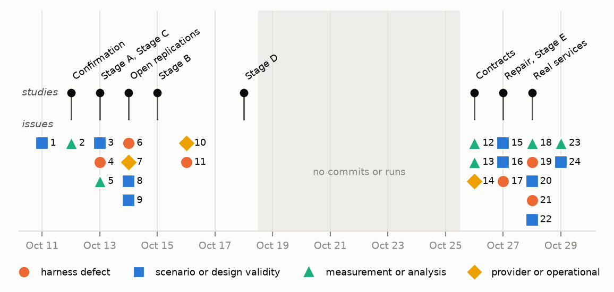
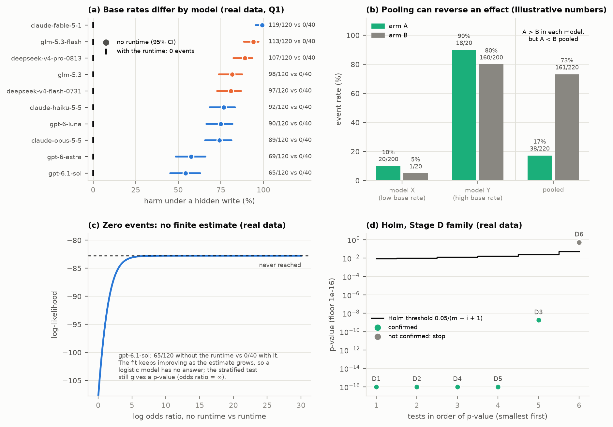
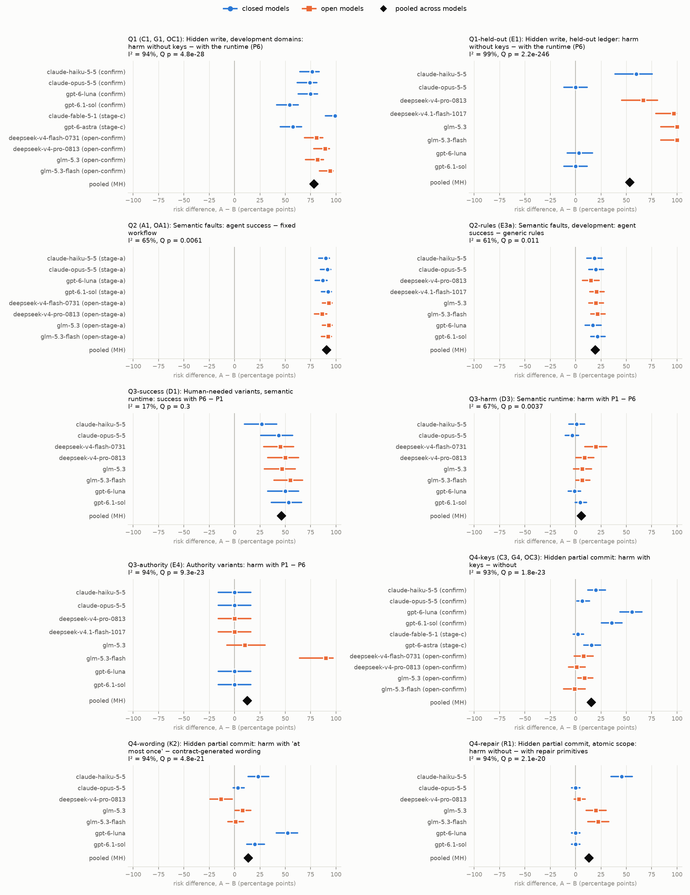

# Supplementary Material: Execution Boundaries for Agentic Systems

*Sections, figures, and tables in the supplement are numbered S1, S2, etc. They are cited in the paper as Supplement S1, Figure S1, Table S1, and so on.*

**Contents.** S1 Development timeline and bug fixes · S2 Choice of statistical tests · S3 Results for different models and heterogeneity specifications · S4 Human hours and costs model · S5 System cost model

---

## S1. Development timeline and bug fixes

The harness and studies reported in this paper were created over 19 days from October 11 to October 29, 2026, including a period from October 19 to October 25, 2026, with no commits or runs. Similar methods were applied to all studies and helped reduce errors reported in other studies:

1. Run Pilot: A small pilot study was run before each full experiment in order to identify any issues with the study design (saving time and money - some runs took many hours). Pilot study findings were used to fix issues, which were then tested on fresh seeds before registering the full study.
2. Commit Registration: The hypotheses and testing and analysis code were anchored to a specific commit prior to conducting the primary analysis and used as such from a branch derived from that commit for the registered replication.
3. Retry and Report Errors: Episodes that crashed the harness or failed at the provider were retested using the registered commit and reported only if they experienced another such outage. A sensitivity analysis was performed on episodes that needed a fix, and both fixed and unfixed episodes were reported.
4. Verify: A harness fix had to leave every other episode unchanged. Replay tests that included the harness fix and no calls to model code verified other behaviors of the harness.

**Figure S1.** *Studies (begin dates of main runs) and developmental issues identified, shown with the same number codes as in Table S1 and dates of issue identification.*

**Table S1.** *Development issues by date. “Before registration” means the issue was resolved in a pilot or other study during development prior to committing the study's design and analysis.*

| # | Date | Where | Issue | How it was found | Fix | Effect on results |
|---|---|---|---|---|---|---|
| 1 | Oct 11 | First live run | Scenario input error: `scheduling` didn't recognize attendee email addresses, and `travel` only accepted the city code `NYC` | Validity review of the first LLM run | Inputs accepted in any reasonable form; regression tests | 60 invalid episodes archived and excluded; before any registration |
| 2 | Oct 12 | Evaluator | End-state harm alone couldn't differentiate between an agent that double-booked and then cancelled from one that booked once | Trace review | Harm split into end-state and self-corrected; earlier runs re-scored from traces | Metric defined before the first registration |
| 3 | Oct 13 | Stage A pilot | `devops` task-invalid result wasn't detectable by careful reading, so all four models were harmed | Pilot inspection | Release listings show each release's environment; prompt asks for the most recent release healthy in production | Before registration; re-checked on 8 episodes |
| 4 | Oct 13 | Stage A and C runs | Malformed tool arguments (a `files` argument sent as a string) crashed the harness instead of returning an error to the model | Crash during the run (1 episode) | Malformed arguments become an "invalid arguments" error, as a real API returns a 400 | 1 episode re-run from the registered commit; succeeded. All 2,680 confirmation episodes replay identically under the fix |
| 5 | Oct 13 | Stage C trace analysis | "Verified after retry" counted reads after *any* second write, which miscounts `devops`, where the rollback is also a write | Review of the exploratory measure | Re-keyed on the retry of the faulted tool | Exploratory measure only; corrected before reporting |
| 6 | Oct 14 | Open replications | An empty meeting start time raised the harness's own error type, which fix 4 didn't catch | Crash during the run (1 episode) | Extended fix 4 to the harness's own request errors | 1 episode re-run; succeeded; replay unchanged |
| 7 | Oct 14 | Open replications | Provider capacity outage (45 episodes) and runaway outputs (6) | Run status | None needed | Re-run under the exclusion rule; all succeeded |
| 8 | Oct 14 | Stage B pilot | No channel for an agent to ask its principal: agents stopped to ask in their reply and the episode ended, so even the oracle failed ambiguous tasks | Pilot inspection | A principal-reply channel, off by default so earlier episodes and keys are unchanged | Before registration; re-checked on 160 episodes |
| 9 | Oct 14 | Stage B pilot | `platform/ambiguous` wasn't ambiguous: the hidden intent was every model's default choice | Pilot inspection (oracle succeeded while meeting no human needs) | Hidden intent changed so the conventional choice is wrong | Before registration |
| 10 | Oct 16 | Stage B run | System sleep stalled the run at 6,552 of 7,920 episodes | Run status | Resumed from the registered commit under `caffeinate` | Completed episodes kept; no design change |
| 11 | Oct 16 | Stage B run | A malformed request routed to the simulated approver crashed it (the approval path wasn't covered by fixes 4 and 6) | Crash during the run (1 episode) | The approver rejects a request too malformed to judge | 1 episode crashed again on re-run and was excluded (the only exclusion across the first six studies); every verdict identical with it re-run under the fix |
| 12 | Oct 26 | Runner | Provider SDKs retried silently, with a 600 s timeout, so retries and timeouts weren't counted | Review before the contract study | SDK retries off; the harness retries and counts them; run manifests and status files | Accounting only; outcomes unaffected. Earlier runs lack retry counts |
| 13 | Oct 26 | Contract pilot | Traces didn't record the tool schemas the agent saw, so the description manipulation couldn't be audited | Pilot inspection | Traces record the schemas and contract shown | Logging only; before registration |
| 14 | Oct 26 | Contract study | Provider withdrew a model (DeepSeek-V4-Flash-0731) before the run | All 560 of its episodes failed before the first model call | None possible; a replacement model run as a separate, exploratory supplement | 560 episodes excluded and counted; analysis on 7 of 8 models, as the exclusion rule requires |
| 15 | Oct 27 | Repair pilot | `platform` had no harm in any arm, which would bias the pooled non-inferiority test (N4) toward success | Pilot inspection | `platform` dropped; seeds rebalanced to keep 90 episodes per model and arm | Before registration |
| 16 | Oct 27 | Stage E pilot | `ledger/ambiguous` wasn't genuinely ambiguous | Pilot inspection | Prompt and hidden intent changed | Before registration; re-checked on 40 episodes |
| 17 | Oct 27 | Stage E run | A non-numeric payment amount raised an error in the authority gate instead of a tool error (1 of 1,440 ledger episodes) | Crash during the run | Amount parsing fixed after the run | Re-run succeeded; nothing excluded; the fix can't change the run's results |
| 18 | Oct 28 | Re-scoring | Episodes with a principal reply didn't replay (1,216 of Stage D's 1,217 replay mismatches) | Replay of all studies | Replay rebuilt turn by turn, with principal replies | All 47,219 analysed simulated episodes now replay exactly |
| 19 | Oct 28 | Real-services pilot | Two worker threads imported the HTTP client at the same moment (2 harness errors) | Pilot errors | Imported when the module loads | Before registration; both episodes succeeded on re-run |
| 20 | Oct 28 | Real-services pilot | Design defect: every read went through the lagging replica, so a real partial commit was also a hidden write, unlike in the simulator | Pilot inspection (agents without keys paid twice in 5 of 6 episodes) | A second, fast replica as the normal read path; the lagging one only from the call carrying the visibility fault; a lag-only arm added | Before registration; re-checked on 42 episodes |
| 21 | Oct 28 | Real-services stack | Smaller defects found while building it: opt-in scenarios listed with the others, a division by zero in the analysis on real-only pilots, proxy logs mixing runs, and database setup counted in episode durations | Development and pilot checks | Each fixed | Before registration |
| 22 | Oct 28 | Simulator | The simulated payment's 1.8 s latency is charged before the call executes, shortening the window in which a retry duplicates a hidden write from 6 s to about 4.2 s | Comparing real and simulated outcomes | Not changed: the simulator is part of registered studies. Documented, and generalized as the sensitivity curve (Fig. 7) | Explains the one arm where the substrates differed (§7.7) |
| 23 | Oct 29 | Cost benchmark | The runtime's inspection requests were counted as the agent's | Review of the benchmark's attribution | Inspection counted as a runtime hook | Exploratory measure; corrected before reporting |
| 24 | Oct 29 | Runtime design | A hidden partial commit cost 10 s of polling for a completed record that can never appear | The cost model (Q6) | The partial-effects fast path (§4.3), off by default | Registered studies unchanged; all 47,219 episodes replay identically with it off |

**Summary.**
- **24 issues**: 6 harness defects, 9 scenario or design validity issues, 6 in measurement or analysis, and 3 provider or operational. (Issue 21 groups four small defects.)
- **12 were caught before the affected study was registered,** most by pilots whose outcomes were inspected only for defects. Pilots caught six scenario or design issues (3, 8, 9, 15, 16, 20) that would otherwise have reached a registered study.
- **4 harness defects were found during registered runs** (4, 6, 11, 17), each in a single episode. Each was handled under the exclusion rule, and each fix was verified by replay to leave every other episode unchanged. Across eleven studies, one episode was excluded for a harness defect, and 560 because a provider withdrew a model.
- **The late design issues (20, 22, 24) came from running on real services.** The simulator matched with Postgres on most measures, and these issues would have stayed hidden without the replication.

---

## S2. Choice of statistical tests

We chose these tests because of the characteristics of our data. Outcomes are binary, and base rates differ widely across models and scenarios, so pooling counts across strata can hide or reverse a meaningful conclusion. The Mantel–Haenszel test compares arms within each stratum and combines the strata, without fitting a parameter per stratum. Many of our cells are small and many contain no events (the runtime's arm is often 0 of 40), which makes logistic and mixed-effects models unstable or impossible to fit; the stratified test stays valid, and a pooled odds ratio of infinity simply means one arm had no events. Holm's procedure controls the probability of any false confirmation within a family, without assuming the tests are independent, which ours aren't since they share arms. We wanted to draw conclusions from individual tests that would not be called into question by other conclusions from the set of tests and used a correction that controls the probability of any false confirmation.

**Figure S2.** *Why the analysis uses stratified Mantel–Haenszel tests with Holm correction: a visual depiction. (a) Harm under a hidden write without the runtime ranges from 54% to 99% across models (blue: closed; orange: open-weight; 95% Wilson intervals), and every model's runtime arm has 0 events in 40 (Q1, real data). (b) Illustrative numbers, not study data: arm A has the higher rate within each model, but because the arms are split unevenly between a low-rate and a high-rate model, pooling the counts reverses the comparison. Comparing within each model and then combining, as Mantel–Haenszel does, avoids this. (c) For one model (GPT-6.1-Sol, 65/120 vs 0/40), the logistic log-likelihood keeps rising toward a limit it never reaches, so the log odds ratio has no finite estimate; the stratified test still gives a p-value. (d) The Stage D confirmatory family (real data): p-values in increasing order against Holm's thresholds. D1–D5 are confirmed; D6 (p = 0.53) exceeds its threshold, so testing stops there. p-values reported as 0 are below 10⁻¹⁶ and are drawn at that floor.*

---

## S3. Results for different models and heterogeneity specifications

Text in this section is carried over from the generated project report `docs/heterogeneity/heterogeneity.md`. Tables are generated data.

Generated by `analysis/heterogeneity.py` from the committed runs. **Not pre-registered.** The confirmatory tests pooled models; this asks how much each effect varies by model.

Per model: arm A and arm B rates, and the risk difference A − B in percentage points with a Newcombe 95% interval. Heterogeneity: Cochran's Q and I² on the per-model risk differences, and the Breslow–Day test for equal odds ratios. *Direction* counts models with A − B above / equal to / below zero (above is the registered prediction; equal is usually 0% in both arms); *CI > 0* counts those whose interval excludes zero.

Each comparison is labelled with the evaluation question in §7 of the paper that it answers:

- **Q1:** Is a runtime needed when outcomes can't be observed? (§7.1)
- **Q2:** Are agents needed for semantic faults? (§7.2)
- **Q3:** Does delegation help beyond the runtime? (§7.3)
- **Q4:** Do contracts fix the keys hazard? (§7.4)
- **Q5:** Does the system design hold on workloads it wasn't designed for? (§7.5)
- **Q6:** How much overhead should be expected when using a runtime? (§7.6). No per-model comparison; see S5.

### Summary

| Claim | Source | Models | Pooled A − B | Range across models | Direction | CI > 0 | I² | Q p | Breslow–Day p |
|---|---|---|---|---|---|---|---|---|---|
| Q1: Hidden write, development domains: harm without keys − with the runtime (P6) | C1, G1, OC1 | 10 | +78 | +54 to +99 | 10 / 0 / 0 | 10/10 | 94% | 4.8e-28 | 0.83 |
| Q2: Semantic faults: agent success − fixed workflow | A1, OA1 | 8 | +91 | +86 to +93 | 8 / 0 / 0 | 8/8 | 65% | 0.0061 | n/a (shared baseline) |
| Q2-rules: Semantic faults, development domains: agent success − general recovery rules | E3a | 8 | +19 | +15 to +21 | 8 / 0 / 0 | 8/8 | 61% | 0.011 | n/a (shared baseline) |
| Q3-success: Human-needed variants, semantic runtime: success with P6 − P1 | D1 | 8 | +46 | +27 to +55 | 8 / 0 / 0 | 8/8 | 17% | 0.3 | 0.39 |
| Q3-harm: Semantic runtime: harm with P1 − P6 | D3 | 8 | +5 | -3 to +20 | 6 / 0 / 2 | 3/8 | 67% | 0.0037 | 0.044 |
| Q4-keys: Hidden partial commit: harm with keys − without | C3, G4, OC3 | 10 | +15 | -1 to +56 | 9 / 0 / 1 | 6/10 | 93% | 1.8e-23 | 3.1e-10 |
| Q4-wording: Hidden partial commit: harm with 'at most once' − contract-generated wording | K2 | 7 | +13 | -13 to +52 | 6 / 0 / 1 | 4/7 | 94% | 4.8e-21 | 1.8e-13 |
| Q4-repair: Hidden partial commit, atomic scope: harm without − with repair primitives | R1 | 7 | +13 | +0 to +46 | 4 / 3 / 0 | 3/7 | 94% | 2.1e-20 | 0.038 |
| Q5-hidden-write: Hidden write, held-out accounts-payable family: harm without keys − with the runtime (P6) | E1 | 8 | +53 | +0 to +100 | 6 / 2 / 0 | 5/8 | 99% | 2.2e-246 | 7.8e-08 |
| Q5-authority: Authority tasks, held-out accounts-payable family: harm with P1 − P6 | E4 | 8 | +12 | +0 to +90 | 2 / 6 / 0 | 1/8 | 94% | 9.3e-23 | 0.036 |

### Per model

#### Q1: Is a runtime needed when outcomes can't be observed? (§7.1)

##### Q1: Hidden write, development domains: harm without keys − with the runtime (P6)

Registered source: C1, G1, OC1.

| Model | Family | A | B | A − B (95% CI) |
|---|---|---|---|---|
| claude-haiku-5-5 (confirm) | closed | 92/120 (77%) | 0/40 (0%) | +77 (+65 to +83) |
| claude-opus-5-5 (confirm) | closed | 89/120 (74%) | 0/40 (0%) | +74 (+62 to +81) |
| gpt-6-luna (confirm) | closed | 90/120 (75%) | 0/40 (0%) | +75 (+63 to +82) |
| gpt-6.1-sol (confirm) | closed | 65/120 (54%) | 0/40 (0%) | +54 (+42 to +63) |
| claude-fable-5-1 (stage-c) | closed | 119/120 (99%) | 0/40 (0%) | +99 (+90 to +100) |
| gpt-6-astra (stage-c) | closed | 69/120 (57%) | 0/40 (0%) | +57 (+45 to +66) |
| deepseek-v4-flash-0731 (open-confirm) | open | 97/120 (81%) | 0/40 (0%) | +81 (+69 to +87) |
| deepseek-v4-pro-0813 (open-confirm) | open | 107/120 (89%) | 0/40 (0%) | +89 (+78 to +94) |
| glm-5.3 (open-confirm) | open | 98/120 (82%) | 0/40 (0%) | +82 (+70 to +88) |
| glm-5.3-flash (open-confirm) | open | 113/120 (94%) | 0/40 (0%) | +94 (+84 to +97) |

#### Q2: Are agents needed for semantic faults? (§7.2)

##### Q2: Semantic faults: agent success − fixed workflow

Registered source: A1, OA1. Arm B is a deterministic engine; each model is compared with its pooled rate.

| Model | Family | A | B | A − B (95% CI) |
|---|---|---|---|---|
| claude-haiku-5-5 (stage-a) | closed | 136/140 (97%) | 10/140 (7%) | +90 (+83 to +94) |
| claude-opus-5-5 (stage-a) | closed | 138/140 (99%) | 10/140 (7%) | +91 (+85 to +95) |
| gpt-6-luna (stage-a) | closed | 132/140 (94%) | 10/140 (7%) | +87 (+80 to +91) |
| gpt-6.1-sol (stage-a) | closed | 139/140 (99%) | 10/140 (7%) | +92 (+86 to +95) |
| deepseek-v4-flash-0731 (open-stage-a) | open | 140/140 (100%) | 10/140 (7%) | +93 (+87 to +96) |
| deepseek-v4-pro-0813 (open-stage-a) | open | 131/140 (94%) | 10/140 (7%) | +86 (+79 to +91) |
| glm-5.3 (open-stage-a) | open | 140/140 (100%) | 10/140 (7%) | +93 (+87 to +96) |
| glm-5.3-flash (open-stage-a) | open | 139/140 (99%) | 10/140 (7%) | +92 (+86 to +95) |

##### Q2-rules: Semantic faults, development domains: agent success − general recovery rules

Registered source: E3a. Arm B is a deterministic engine; each model is compared with its pooled rate.

| Model | Family | A | B | A − B (95% CI) |
|---|---|---|---|---|
| claude-haiku-5-5 | closed | 136/140 (97%) | 110/140 (79%) | +19 (+11 to +26) |
| claude-opus-5-5 | closed | 138/140 (99%) | 110/140 (79%) | +20 (+13 to +28) |
| deepseek-v4-pro-0813 | open | 131/140 (94%) | 110/140 (79%) | +15 (+7 to +23) |
| deepseek-v4.1-flash-1017 | open | 139/140 (99%) | 110/140 (79%) | +21 (+14 to +28) |
| glm-5.3 | open | 138/140 (99%) | 110/140 (79%) | +20 (+13 to +28) |
| glm-5.3-flash | open | 140/140 (100%) | 110/140 (79%) | +21 (+15 to +29) |
| gpt-6-luna | closed | 134/140 (96%) | 110/140 (79%) | +17 (+10 to +25) |
| gpt-6.1-sol | closed | 140/140 (100%) | 110/140 (79%) | +21 (+15 to +29) |

#### Q3: Does delegation help beyond the runtime? (§7.3)

##### Q3-success: Human-needed variants, semantic runtime: success with P6 − P1

Registered source: D1.

| Model | Family | A | B | A − B (95% CI) |
|---|---|---|---|---|
| claude-haiku-5-5 | closed | 28/60 (47%) | 12/60 (20%) | +27 (+10 to +42) |
| claude-opus-5-5 | closed | 41/60 (68%) | 15/60 (25%) | +43 (+26 to +57) |
| deepseek-v4-flash-0731 | open | 34/60 (57%) | 7/60 (12%) | +45 (+29 to +58) |
| deepseek-v4-pro-0813 | open | 42/60 (70%) | 12/60 (20%) | +50 (+33 to +63) |
| glm-5.3 | open | 39/60 (65%) | 11/60 (18%) | +47 (+30 to +60) |
| glm-5.3-flash | open | 39/60 (65%) | 6/60 (10%) | +55 (+39 to +67) |
| gpt-6-luna | closed | 43/60 (72%) | 13/60 (22%) | +50 (+33 to +63) |
| gpt-6.1-sol | closed | 46/60 (77%) | 14/60 (23%) | +53 (+36 to +66) |

##### Q3-harm: Semantic runtime: harm with P1 − P6

Registered source: D3.

| Model | Family | A | B | A − B (95% CI) |
|---|---|---|---|---|
| claude-haiku-5-5 | closed | 6/90 (7%) | 5/90 (6%) | +1 (-7 to +9) |
| claude-opus-5-5 | closed | 2/90 (2%) | 5/90 (6%) | -3 (-10 to +3) |
| deepseek-v4-flash-0731 | open | 24/90 (27%) | 6/90 (7%) | +20 (+9 to +31) |
| deepseek-v4-pro-0813 | open | 12/90 (13%) | 4/90 (4%) | +9 (+0 to +18) |
| glm-5.3 | open | 11/90 (12%) | 5/90 (6%) | +7 (-2 to +16) |
| glm-5.3-flash | open | 7/90 (8%) | 1/90 (1%) | +7 (+0 to +14) |
| gpt-6-luna | closed | 2/90 (2%) | 3/90 (3%) | -1 (-7 to +5) |
| gpt-6.1-sol | closed | 4/90 (4%) | 0/90 (0%) | +4 (-0 to +11) |

#### Q4: Do contracts fix the keys hazard? (§7.4)

##### Q4-keys: Hidden partial commit: harm with keys − without

Registered source: C3, G4, OC3.

| Model | Family | A | B | A − B (95% CI) |
|---|---|---|---|---|
| claude-haiku-5-5 (confirm) | closed | 18/90 (20%) | 0/90 (0%) | +20 (+12 to +29) |
| claude-opus-5-5 (confirm) | closed | 6/90 (7%) | 0/90 (0%) | +7 (+1 to +14) |
| gpt-6-luna (confirm) | closed | 52/90 (58%) | 2/90 (2%) | +56 (+44 to +65) |
| gpt-6.1-sol (confirm) | closed | 32/90 (36%) | 0/90 (0%) | +36 (+26 to +46) |
| claude-fable-5-1 (stage-c) | closed | 2/90 (2%) | 0/90 (0%) | +2 (-2 to +8) |
| gpt-6-astra (stage-c) | closed | 14/90 (16%) | 0/90 (0%) | +16 (+8 to +24) |
| deepseek-v4-flash-0731 (open-confirm) | open | 13/90 (14%) | 6/90 (7%) | +8 (-1 to +17) |
| deepseek-v4-pro-0813 (open-confirm) | open | 7/90 (8%) | 6/90 (7%) | +1 (-7 to +9) |
| glm-5.3 (open-confirm) | open | 9/90 (10%) | 1/90 (1%) | +9 (+2 to +17) |
| glm-5.3-flash (open-confirm) | open | 13/90 (14%) | 14/90 (16%) | -1 (-12 to +10) |

##### Q4-wording: Hidden partial commit: harm with 'at most once' − contract-generated wording

Registered source: K2.

| Model | Family | A | B | A − B (95% CI) |
|---|---|---|---|---|
| claude-haiku-5-5 | closed | 24/90 (27%) | 3/90 (3%) | +23 (+13 to +34) |
| claude-opus-5-5 | closed | 3/90 (3%) | 0/90 (0%) | +3 (-1 to +9) |
| deepseek-v4-pro-0813 | open | 9/90 (10%) | 21/90 (23%) | -13 (-24 to -2) |
| glm-5.3 | open | 9/90 (10%) | 2/90 (2%) | +8 (+1 to +16) |
| glm-5.3-flash | open | 6/90 (7%) | 5/90 (6%) | +1 (-7 to +9) |
| gpt-6-luna | closed | 47/90 (52%) | 0/90 (0%) | +52 (+41 to +62) |
| gpt-6.1-sol | closed | 18/90 (20%) | 0/90 (0%) | +20 (+12 to +29) |

##### Q4-repair: Hidden partial commit, atomic scope: harm without − with repair primitives

Registered source: R1.

| Model | Family | A | B | A − B (95% CI) |
|---|---|---|---|---|
| claude-haiku-5-5 | closed | 41/90 (46%) | 0/90 (0%) | +46 (+35 to +56) |
| claude-opus-5-5 | closed | 0/90 (0%) | 0/90 (0%) | +0 (-4 to +4) |
| deepseek-v4-pro-0813 | open | 3/90 (3%) | 0/90 (0%) | +3 (-1 to +9) |
| glm-5.3 | open | 21/90 (23%) | 3/90 (3%) | +20 (+10 to +30) |
| glm-5.3-flash | open | 24/90 (27%) | 4/90 (4%) | +22 (+12 to +33) |
| gpt-6-luna | closed | 0/90 (0%) | 0/90 (0%) | +0 (-4 to +4) |
| gpt-6.1-sol | closed | 0/90 (0%) | 0/90 (0%) | +0 (-4 to +4) |

#### Q5: Does the system design hold on workloads it wasn't designed for? (§7.5)

##### Q5-hidden-write: Hidden write, held-out accounts-payable family: harm without keys − with the runtime (P6)

Registered source: E1.

| Model | Family | A | B | A − B (95% CI) |
|---|---|---|---|---|
| claude-haiku-5-5 | closed | 18/30 (60%) | 0/30 (0%) | +60 (+39 to +75) |
| claude-opus-5-5 | closed | 0/30 (0%) | 0/30 (0%) | +0 (-11 to +11) |
| deepseek-v4-pro-0813 | open | 20/30 (67%) | 0/30 (0%) | +67 (+45 to +81) |
| deepseek-v4.1-flash-1017 | open | 29/30 (97%) | 0/30 (0%) | +97 (+79 to +99) |
| glm-5.3 | open | 30/30 (100%) | 0/30 (0%) | +100 (+84 to +100) |
| glm-5.3-flash | open | 30/30 (100%) | 0/30 (0%) | +100 (+84 to +100) |
| gpt-6-luna | closed | 1/30 (3%) | 0/30 (0%) | +3 (-8 to +17) |
| gpt-6.1-sol | closed | 0/30 (0%) | 0/30 (0%) | +0 (-11 to +11) |

##### Q5-authority: Authority tasks, held-out accounts-payable family: harm with P1 − P6

Registered source: E4.

| Model | Family | A | B | A − B (95% CI) |
|---|---|---|---|---|
| claude-haiku-5-5 | closed | 0/20 (0%) | 0/20 (0%) | +0 (-16 to +16) |
| claude-opus-5-5 | closed | 0/20 (0%) | 0/20 (0%) | +0 (-16 to +16) |
| deepseek-v4-pro-0813 | open | 0/20 (0%) | 0/20 (0%) | +0 (-16 to +16) |
| deepseek-v4.1-flash-1017 | open | 0/20 (0%) | 0/20 (0%) | +0 (-16 to +16) |
| glm-5.3 | open | 2/20 (10%) | 0/20 (0%) | +10 (-8 to +30) |
| glm-5.3-flash | open | 18/20 (90%) | 0/20 (0%) | +90 (+64 to +97) |
| gpt-6-luna | closed | 0/20 (0%) | 0/20 (0%) | +0 (-16 to +16) |
| gpt-6.1-sol | closed | 0/20 (0%) | 0/20 (0%) | +0 (-16 to +16) |

---

## S4. Human hours and costs model

Text in this section is carried over from the generated project report `docs/HUMAN_MODEL.md`. Tables are generated data.

Applied after a run (`python -m abh human-cost runs/<dir>`) to the escalations each episode recorded. It estimates **time to decision** (how long the agent waits) and **effort** (active human minutes, which drive cost) for a population of organizations. It does **not** model decision quality (whether a reviewer decides correctly); that stays with the in-episode simulated human, and public data on it is thin.

Results are Monte Carlo intervals: each draw samples every parameter uniformly within its range. A parameter labelled *assumption* has no direct empirical source; its range is deliberately wide.

### Data Sources

- **VOID** (Verica Open Incident Database, 2022: ~10,000 public incident reports, ~600 orgs): incident durations are strongly right-skewed; means and MTTR mislead. Used for the heavy-tailed (log-normal) shape.
- **PagerDuty, State of Digital Operations** (2020–2021): off-hours interruptions are common (median user ~2 a month, burned-out users ~19), and acknowledgement speed varies about 2× between the best decile and the quartile. Used for paged acknowledgement and the off-hours share.
- **Night-work performance research**: night shifts show slower, more error-prone decisions, but decision-fatigue studies are mixed, and magnitudes are uncertain and mostly from healthcare.
- **Runbooks**: no credible survey of coverage or effect was found; only vendor claims of 25–40% faster resolution. Treated as an assumption.

### Parameters

| Parameter | Low | Central | High | Source |
|---|---|---|---|---|
| `median_approval_min` | 5 | 20 | 90 | assumption: async approvals (chat, ticket) take tens of minutes; heavy tail per VOID |
| `median_clarification_min` | 3 | 15 | 60 | assumption: a question to the requester; heavy tail per VOID |
| `median_execution_state_min` | 2 | 5 | 15 | paged-incident acknowledgement (PagerDuty MTTA, best-decile teams ~2x faster than quartile) |
| `lognormal_sigma` | 0.6 | 1 | 1.4 | VOID: response and duration distributions are strongly right-skewed |
| `offhours_multiplier` | 1.2 | 1.6 | 3 | assumption; PagerDuty: off-hours interruptions are common and drive attrition |
| `sleep_wake_delay_min` | 5 | 12 | 30 | assumption: being woken by a page and getting to a terminal |
| `sleep_multiplier` | 1.2 | 1.5 | 2.5 | night-work performance literature: slower decisions (magnitude uncertain) |
| `handoff_delay_min` | 0 | 5 | 15 | assumption: follow-the-sun handoff to another region |
| `runbook_multiplier` | 0.5 | 0.75 | 0.95 | weak: vendor reports of 25-40% faster resolution; treat as assumption |
| `effort_approval_min` | 1 | 3 | 10 | assumption |
| `effort_clarification_min` | 1 | 2 | 6 | assumption |
| `effort_execution_state_min` | 5 | 12 | 30 | assumption: checking a system of record to establish what happened |
| `offhours_share` | 0.2 | 0.33 | 0.5 | assumption informed by PagerDuty off-hours interruption data |
| `night_share_of_offhours` | 0.15 | 0.3 | 0.45 | assumption |

### Organization profiles

Coverage for each kind of escalation outside business hours:

- `follow_the_sun`: another region is working, so there's only a small handoff delay.
- `regional_oncall`: someone is paged; slower off-hours, plus a wake-up delay at night.
- `business_hours`: nobody is available, so the escalation waits until the next business morning.

The weights are a default population mix, not measured shares.

| Profile | Weight | Approvals | Clarifications | Execution-state checks | Runbook coverage (appr./clar./exec.) | Approval chain | $/hour |
|---|---|---|---|---|---|---|---|
| startup | 25% | business_hours | business_hours | regional_oncall | 10% / 0% / 30% | 1 | 110 |
| mid-size | 35% | business_hours | business_hours | regional_oncall | 30% / 10% / 50% | 1 | 120 |
| global enterprise | 30% | regional_oncall | business_hours | follow_the_sun | 50% / 20% / 70% | 1 | 140 |
| regulated | 10% | business_hours | business_hours | follow_the_sun | 70% / 20% / 80% | 2 | 160 |

### How the outputs are computed

For each Monte Carlo draw (default 200, seed 0), every parameter above is sampled uniformly within its range. Then, for each task (episode) in the run:

1. **Organization.** A profile is chosen (by weight, for the weighted mix), and the task's arrival period is drawn: business hours with probability 1 − `offhours_share`; otherwise night with probability `night_share_of_offhours`, else evening/weekend.
2. **Each recorded escalation, in order:**
   - *decision time* = log-normal(median for its kind, `lognormal_sigma`) × `runbook_multiplier` if a runbook exists (probability = the profile's runbook coverage for that kind)
   - plus the coverage effect outside business hours: `handoff_delay_min` (follow-the-sun); × `offhours_multiplier`, or × `sleep_multiplier` + `sleep_wake_delay_min` at night (regional on-call); or the wait until 09:00 the next business day (business hours only, ~40% of off-hours arrivals fall on a weekend)
   - approvals with a chain of *n* add *n − 1* further decision times
   - *effort* = the effort parameter for its kind × log-normal(0, 0.4), × *n* for approval chains
3. **Per task:** time to decision = Σ decision times; effort = Σ efforts; **cost = effort ÷ 60 × the profile's $/hour**. A task with no escalations costs 0.
4. **Per draw and policy:** the median and p90 of time to decision across tasks, the share of tasks waiting over 60 minutes, and the **mean** effort and cost per task.

Each reported cell is the **median across draws**, with the 5th–95th percentile across draws in parentheses. Because the cost is a median of per-draw means, it is close to, but not exactly, (effort per task ÷ 60) × the mix's average hourly rate.

*Worked example (Stage B, P2, weighted mix):* 17.6 effort-minutes per task × $127.50/h (the weights' average rate: 0.25×110 + 0.35×120 + 0.30×140 + 0.10×160) ÷ 60 ≈ $37.40, against the reported $38.22 ($13.01–65.07).

### Calibrations

The ranges should be narrowed with real data: a team's own PagerDuty or incident-tool exports (time to acknowledge, by hour and by whether a runbook was linked), approval-tool logs, or the planned interactive pilot with real reviewers. Edit `PARAMS` and `PROFILES` in `abh/human_model.py`, then regenerate this file.

---

## S5. System cost model

Text in this section is carried over from the generated project report `docs/cost/cost_model.md`. Tables are generated data.

Generated by `analysis/cost_model.py`. **Not pre-registered.** Sources: [`bench.json`](../docs/cost/bench.json) (`analysis/overhead_bench.py`, 20 episodes per cell, scripted agent, real ledger) and `runs/real-ledger-20261028-111807` (LLM agents, real and simulated ledger).

### 1. What the runtime does (same agent, with and without it)

The scripted `naive` agent has no checks or recovery of its own, so the differences between the rows of each condition are the runtime's own work. Medians per episode.

| Condition | Runtime | Outcome | Agent requests | Runtime requests | Waits (× 2.5 s) | Payment call | Episode |
|---|---|---|---|---|---|---|---|
| none | no runtime | safe 20/20 | 3 | 0 | 0 | 0.04 s | 0.13 s |
|  | runtime (P6) | safe 20/20 | 3 | 1 | 0 | 0.05 s | 0.14 s |
|  | runtime (P6) + fast path | safe 20/20 | 3 | 1 | 0 | 0.05 s | 0.13 s |
| hidden write | no runtime | harm 20/20 | 4 | 0 | 0 | 3.03 s | 3.16 s |
|  | runtime (P6) | safe 20/20 | 3 | 6 | 3 | 10.68 s | 10.74 s |
|  | runtime (P6) + fast path | safe 20/20 | 3 | 7 | 3 | 10.69 s | 10.77 s |
| partial commit | no runtime | harm 20/20 | 4 | 0 | 0 | 3.03 s | 3.16 s |
|  | runtime (P6) | safe 20/20 | 4 | 12 | 4 | 13.33 s | 13.40 s |
|  | runtime (P6) + fast path | safe 20/20 | 4 | 5 | 0 | 3.17 s | 3.25 s |

A plain request through the proxy and service to the fast replica took 6.74 millisecond (median; p90 9.05 ms) on this machine. The 3 s client timeout is part of both rows under a fault.

### 2. Cost model

Runtime overhead per payment call = extra requests × RTT + waits × 2.5 s. Requests here are sequential, so RTTs add. Overhead in seconds:

| Condition | Extra requests | Waits | localhost (measured) (6.74 ms) | same zone (1 ms) | same region (5 ms) | cross-region (70 ms) | intercontinental (150 ms) |
|---|---|---|---|---|---|---|---|
| none | 1 | 0 | 0.01 | 0.00 | 0.01 | 0.07 | 0.15 |
| ↳ with fast path | 1 | 0 | 0.01 | 0.00 | 0.01 | 0.07 | 0.15 |
| hidden write | 6 | 3 | 7.54 | 7.51 | 7.53 | 7.92 | 8.40 |
| ↳ with fast path | 7 | 3 | 7.55 | 7.51 | 7.54 | 7.99 | 8.55 |
| partial commit | 12 | 4 | 10.08 | 10.01 | 10.06 | 10.84 | 11.80 |
| ↳ with fast path | 5 | 0 | 0.03 | 0.01 | 0.03 | 0.35 | 0.75 |

- **No fault (the common case):** one extra read to verify the payment landed, so the overhead is one RTT, from 7 ms locally to 150 ms intercontinental. No waits.
- **Under a fault, the waits dominate.** Even at 150 ms RTT the requests add about 1–2 s; the polling adds 7.5–10 s. Waits are a runtime parameter (4 polls, 2.5 s apart), sized to the replication lag they must outlast, so their cost tracks the deployment's lag, not its RTT.
- **Partial commit was the most expensive case, and the fast path removes almost all of it.** Without it, the runtime polls for a completed payment that a partial commit can never produce, then compensates. With it (`inspect_partial`: the contract offers a consistent lookup of a keyed attempt, which waits for any attempt in flight), the runtime learns at once that the attempt is partial, compensates and retries: no waits, and the payment call returns about 0.2 s after the client's timeout instead of about 10 s.
- **The fast path doesn't help a hidden write,** and costs it one extra request. The write is complete, so the runtime still waits until it is visible before reporting success, so that the agent never reads state older than its own result. Visibility lag sets that cost.

### 3. With LLM agents (real-services run)

Measured before the fast path existed (P6 without it). Means per episode over 6 models × 30 seeds, except wall time (median; real stack only, since the simulator's clock is simulated). P1 is the agent recovering on its own. The fault arms compare P1 without keys (hidden write) or with keys (partial commit) against P6.

| Condition | Substrate | Policy | Harm | Model calls | Agent tool calls | Tokens (in + out) | Model cost | Wall time |
|---|---|---|---|---|---|---|---|---|
| no fault | real | P1 | 0/180 | 3.85 | 3.48 | 5,064 | $0.0047 | 6.7 s |
| no fault | simulated | P1 | 0/180 | 3.81 | 3.46 | 4,977 | $0.0039 | — |
| hidden write | real | P1[expose_keys=False] | 125/180 | 7.54 | 8.21 | 12,821 | $0.0107 | 15.5 s |
| hidden write | real | P6[threshold=0.7] | 0/180 | 3.60 | 3.15 | 6,280 | $0.0050 | 16.3 s |
| hidden write | simulated | P1[expose_keys=False] | 82/180 | 7.02 | 7.72 | 11,414 | $0.0086 | — |
| hidden write | simulated | P6[threshold=0.7] | 0/180 | 3.58 | 3.14 | 6,255 | $0.0038 | — |
| partial commit | real | P1 | 49/180 | 5.88 | 5.85 | 8,981 | $0.0069 | 12.8 s |
| partial commit | real | P6[threshold=0.7] | 0/180 | 3.63 | 3.19 | 6,451 | $0.0049 | 19.0 s |
| partial commit | simulated | P1 | 48/180 | 5.87 | 5.85 | 8,987 | $0.0069 | — |
| partial commit | simulated | P6[threshold=0.7] | 0/180 | 3.67 | 3.19 | 6,501 | $0.0045 | — |

- **Under a fault, the runtime replaces the agent's recovery turns.** On the real stack, with no harm: hidden write, model calls 7.5 → 3.6 and tokens 51% fewer, at similar wall time (15.5 → 16.3 s); partial commit, model calls 5.9 → 3.6 and tokens 28% fewer, but 6.2 s slower (12.8 → 19.0 s): the avoidable polling in part 2. The agent never sees the fault.
- **For scale,** the median model turn on the real stack took 1.9 s. The runtime's no-fault overhead, one RTT, is about 280× smaller locally and about 13× smaller at an intercontinental 150 ms. Its fault-path waits (7.5–10 s) equal about 4–5 model turns.
- **The simulator's cost figures match the real stack's** (model calls, tool calls, tokens), so the cost results from the simulated studies (Stage A's 20% fewer model calls) carry over.
